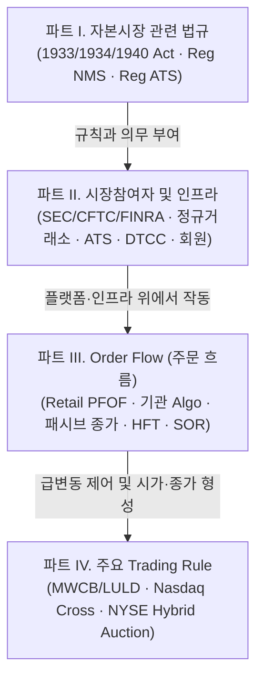

# 미국 자본시장 구조 완전 가이드

> 원본 문서: `[20261113]_미국_자본시장구조.pdf` (총 4파트, 원문 85쪽)  
> 본 저장소는 원본 문서의 모든 법규·기관·주문 흐름·거래 규칙을 **14개 챕터의 Markdown 문서**로 체계적으로 세분화하고, 금융·시장미시구조 입문자도 직관적으로 이해할 수 있도록 **핵심 용어 사전, 쉬운 비유와 숫자 예시, 한국 자본시장(KRX·넥스트레이드) 비교, 원문 보충 해설**을 덧붙여 구성했습니다.

---

## 한눈에 보는 전체 아키텍처

미국 주식시장은 한국처럼 단일 거래소(KRX) 중심에서 출발해 대체거래소가 막 도입된 구조와 달리, **16개 이상의 정규 거래소 + 40여 개의 대체거래소(ATS/Dark Pool) + 장외 도매 마켓메이커(Wholesaler)**가 실시간 네트워크로 얽혀 경쟁하는 **다층·분절 시장(Fragmented Market)**입니다.

---

## 챕터별 세분화 목차 (총 14개 챕터)

### 파트 I. 자본시장 관련 법규
| 챕터 | 파일명 | 원문 범위 | 핵심 주제 |
| :--- | :--- | :--- | :--- |
| **Ch 01** | [01-legal-framework.md](part1-regulations/01-legal-framework.md) | Part I - 1 (p.2~3) | 의회 제정법(`U.S.C.`) vs 행정규칙(`C.F.R.`), 한·미 법규 체계 비교, 미국 법조문 읽고 쓰기 |
| **Ch 02** | [02-securities-acts.md](part1-regulations/02-securities-acts.md) | Part I - 2.1, 2.2 개요, 2.3 (p.4~5, 13) | 1933년 증권법(발행시장), 1934년 증권거래소법(유통시장), 1940년 투자회사법·투자자문업법 |
| **Ch 03** | [03-reg-nms-and-reg-ats.md](part1-regulations/03-reg-nms-and-reg-ats.md) | Part I - 2.2 Reg NMS & Reg ATS (p.6~12) | Reg NMS Rule 602~613(NBBO·PFOF·슬리피지·Trade-through·Sub-Penny·CAT), Reg ATS Rule 301~304(5% 룰·Form ATS-N) |

### 파트 II. 시장참여자
| 챕터 | 파일명 | 원문 범위 | 핵심 주제 |
| :--- | :--- | :--- | :--- |
| **Ch 04** | [04-regulators-and-sros.md](part2-participants/04-regulators-and-sros.md) | Part II - 1 (p.15~16) | 연방 규제기관(SEC vs CFTC), 자율규제기구(FINRA vs SROs) 권한 및 관할 |
| **Ch 05** | [05-national-exchanges.md](part2-participants/05-national-exchanges.md) | Part II - 2.1 (p.17~28) | 정규 거래소(Lit), SIP·NBBO 유통 3계층과 MDI Rule, 4대 그룹 현황, Maker-Taker/Inverted/Flat-Fee, 비거래 수익, 2024년 4사 수익 비교 |
| **Ch 06** | [06-ats-and-competition.md](part2-participants/06-ats-and-competition.md) | Part II - 2.2~2.3 (p.28~33) | ECN·Dark Pool·Crossing Network, IB 주도형 vs 독립 중개형, ATS 4대 수익모델, 정규거래소 대응, 2024~2025년 시장 점유율 |
| **Ch 07** | [07-clearing-and-members.md](part2-participants/07-clearing-and-members.md) | Part II - 3~4 (p.34~38) | DTCC 지배구조 및 자회사(NSCC Novation/CNS/VaR · FICC · DTC), Broker vs Dealer, 청산소 회원(GCM·DCM·NCM) |

### 파트 III. Order Flow (주문 흐름)
| 챕터 | 파일명 | 원문 범위 | 핵심 주제 |
| :--- | :--- | :--- | :--- |
| **Ch 08** | [08-retail-order-flow.md](part3-order-flow/08-retail-order-flow.md) | Part III - 1 (p.40~43) | 개인 주문 흐름, Retail Broker → Wholesaler, PFOF 및 Rule 606, Cream-Skimming(독성 평가), Clean Flow 내부화 vs Lit 호가장 독성 오염 |
| **Ch 09** | [09-institutional-algo-flow.md](part3-order-flow/09-institutional-algo-flow.md) | Part III - 2 (p.44~49) | 기관 알고리즘 주문, 슬리피지(기회비용·역선택), Parent Order Slicing(VWAP/TWAP/POV/IS), Dark-First Waterfall, ISO 심층 해부 & CAT 감시 |
| **Ch 10** | [10-passive-and-hft-flow.md](part3-order-flow/10-passive-and-hft-flow.md) | Part III - 3~4 (p.50~55) | 패시브 자금 장마감 집중(Tracking Error=0)·불균형 차익거래·장중 공동화, HFT 지연시간 차익거래(SIP vs Direct Feed)·Post-Only/Pegged/Mass Cancel·CME-NJ 마이크로웨이브, 코로케이션/스피드범프 |
| **Ch 11** | [11-smart-order-routing.md](part3-order-flow/11-smart-order-routing.md) | Part III - 5 (p.56~59) | SOR(Smart Order Routing): Taker Order(IOC, Dark-First, Inverted→Flat→Maker-Taker) vs Maker Order(Post-Only, Routing Score, 자방 NBBO 가격별 전략) |

### 파트 IV. 주요 Trading Rule
| 챕터 | 파일명 | 원문 범위 | 핵심 주제 |
| :--- | :--- | :--- | :--- |
| **Ch 12** | [12-price-stabilization.md](part4-trading-rules/12-price-stabilization.md) | Part IV - 1 (p.61~62 + 관련 조항) | 가격안정화 장치: 전 시장 MWCB(7%/13%/20%), 개별 종목 LULD(5분 기준가 밴드·15초·5분 정지), NYSE/Nasdaq 옥션 안정화 장치 |
| **Ch 13** | [13-opening-closing-nasdaq.md](part4-trading-rules/13-opening-closing-nasdaq.md) | Part IV - 2.1~2.2 (p.63~72) | 미국 시가/종가 거래량 비중 및 병렬 경매 특징, Nasdaq Opening/Closing Cross 타임라인, Late LOO/LOC Price Sliding, EP 결정 4단계, IO/CIO, NOII, 연장 케이스 |
| **Ch 14** | [14-opening-closing-nyse.md](part4-trading-rules/14-opening-closing-nyse.md) | Part IV - 2.3 (p.73~85) | NYSE DMM 주도 하이브리드 옥션, Opening/Closing 6단계, Direct vs Manual, Collar Reference Price, D-Order 스텔스·상태전이, CO·DMM Interest, Parity 1/N 배분 |

---

## 한국 자본시장(KRX) vs 미국 자본시장 핵심 비교

| 비교 축 | 한국 (KRX 중심 + NXT) | 미국 (다중 거래소 + ATS + OTC) |
| :--- | :--- | :--- |
| **기본 법전** | 단일 통합법(「자본시장법」) 중심 | 시대·영역별 연방 단행법(1933/1934/1940) + SEC Rules |
| **최우선 가격 통합** | 단일 호가창 중심(복수시장 SOR 도입 초기) | 법정 `NBBO`(SIP 집계) + `Rule 611` Trade-through 금지 |
| **장외/비공개 체결** | 시간외 대량매매·NXT 등 제한적 | 전체 거래대금의 **약 46~52%**(OTC 내부화 35~38% + ATS 11~14%) |
| **개인 주문 수수료 모델** | 브로커 위탁매매 수수료 기반 | `Zero Commission` + 도매상(Wholesaler)의 `PFOF` 기반 |
| **시가·종가 경매 중 접속매매** | 단일가 매매 시간 동안 접속체결 **전면 중단** | 상장거래소 옥션 중에도 타 거래소/장내 접속체결 **병렬 지속** |
| **가격제한폭** | 일일 상하한가 **±30%** + 정적/동적 VI(2분) | 일일 상하한가 없음, 대신 **LULD** 실시간 동적 밴드(5분 정지) |

---

## 각 챕터의 추가 설명자료 읽는 법

모든 챕터 문서에는 원문 PDF의 내용을 100% 충실히 정리한 본문 외에, 이해를 돕기 위해 다음과 같은 표식의 설명자료가 포함되어 있습니다.

- **핵심 용어 사전**: 원문에 등장하는 영어 약어(`NBBO`, `PFOF`, `CNS`, `ISO`, `D-Order` 등)와 미시구조 용어의 직관적 풀이
- **쉬운 비유 & 숫자 예시**: "실제로 1,000주를 살 때 센트/밀 단위로 돈이 어떻게 오가는가?"를 숫자로 직접 계산한 예시
- **한국 시장(KRX) 비교 & 실무 인사이트**: 한국 투자자/실무자 관점에서 왜 이런 제도가 존재하는지 연결한 해설
- **원문 보충 노트**: 원본 PDF 내 미작성 구역(`// 작성 예정 //`), 요약만 있던 파트(Part IV 1장), 표와 본문 간 사소한 불일치(예: NYSE DMM Interest 개시 시각) 등을 명확히 구분해 보완한 주석
