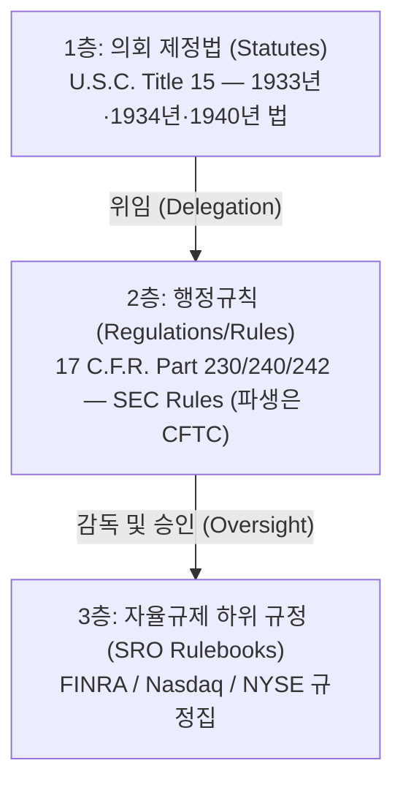

# Chapter 01. 미국 자본시장 법규 체계

> **원문 위치**: 파트 I. 자본시장 관련 법규 > 1. 법규 체계 (원문 p.2~3)  
> **이 챕터의 핵심 질문**:
> 1. 미국 증권 법규는 어떤 계층(`의회 제정법` → `행정규칙` → `자율규제 규정`)으로 구성되는가?
> 2. 한국 자본시장법 체계와 비교했을 때 무엇이 다른가?
> 3. 실무에서 마주치는 `15 U.S.C. §78j(b)`나 `17 C.F.R. §242.611` 같은 조문 표기를 어떻게 읽고 부르는가?

---

## 1. 미국 법규의 2대 축과 3단 계층 구조

미국의 법률 체계는 크게 의회가 제정한 **의회 제정법(Statutes)**과 행정기관이 위임받아 제정한 **행정규칙(Regulations/Rules)**으로 나뉩니다.

- **의회 제정법 (`Statutes`)**: 연방의회(Congress)를 통과한 법률로, 주제별로 **54개의 Title**로 분류된 연방 법전(**U.S.C.**; United States Code)에 수록됩니다. 증권 관련 법률은 **Title 15 (Commerce and Trade)**에 배정되어 있습니다.
- **행정규칙 (`Regulations / Rules`)**: 의회가 제정한 법률의 위임을 받아 행정기관(독립규제기관 포함)이 만든 세부 규칙으로, 연방행정규칙집(**C.F.R.**; Code of Federal Regulations)에 수록됩니다. 증권 관련 행정규칙은 **SEC**(증권거래위원회)가 제정하며 **Title 17**에 실립니다.
- **하위 규정 (`SRO Rulebooks`)**: 거래소나 자율규제기구(FINRA, Nasdaq, NYSE 등)가 자체적으로 운영하는 세부 업무 규정입니다.

---

## 2. 한·미 자본시장 법규 체계 비교

미국 증권시장 관련 법 체계를 한국 자본시장법 체계와 비교하면 다음과 같습니다.

| 구분 | 미국 법규 체계 | 한국 법규 체계 |
| :--- | :--- | :--- |
| **법 (Statute)** | - `Securities Act of 1933` - `Securities Exchange Act of 1934` - `Investment Company Act of 1940` - `Investment Advisers Act of 1940` | - `자본시장과 금융투자업에 관한 법률` (자본시장법) |
| **시행규칙 / 행정규칙** | - `SEC Rules` (`17 C.F.R. Part 230 / 240 / 242` 등) - 참고(파생상품): `CFTC Rules` | - 자본시장법 시행령 - 금융투자업규정(금융위원회 고시) |
| **하위 규정** | - `SRO Rulebooks` (`FINRA / Nasdaq / NYSE`) | - 한국거래소 업무규정 및 시행세칙 등 |

---

## 3. 원문 실무 팁: 미국 법규 쓰기 및 읽기

### 3.1 의회 제정법 (`U.S.C.`)

- **기본 표기법**: `[Title 번호] + [U.S.C.] + [§] + [조항 번호] + [(발행연도 - 선택)]`
- **조항 번호 계층 순서**: `Section: §` → `Subsection: (a)` → `Paragraph: (1)` → `Subparagraph: (A)` → `Clause: (i)`
- **기술 예시**:
  - `15 U.S.C. § 78m(d)(1)(A)(i)`
  - `15 U.S.C. § 78j(b) (2018)`
- **읽는 방법 예시**:
  - *"Title fifteen, U.S.C., Section seventy-eight-m, subsection d, paragraph 1, subparagraph A, clause i"*
- **조항 범위 표현**:
  - `§§ 78a - 78rr` *(§를 두 번 겹쳐 `§§`로 쓰면 복수 섹션 범위를 뜻함)*
- **실무 호칭 관례**:
  - 실무에서는 `U.S.C.` 번호 대신 **원법률 명칭과 원래 법안의 섹션 번호**를 많이 사용합니다.
  - 예: `15 U.S.C. § 78j(b)` (1934년 법의 원조항 Section 10(b)) → **"Exchange Act Section ten-b"**

> 📝 **원문 노트 — 조문 번호 변환 주의**:  
> 원문 팁 하단에 `15 U.S.C. §10(b) : "Exchange Act Section ten-b"`로 축약 표기된 부분이 있으나, 정확한 U.S.C. 편철 위치는 2쪽 위 예시와 동일한 **`15 U.S.C. § 78j(b)`**이며, **`Section 10(b)`**는 원법률(Securities Exchange Act of 1934) 기준 섹션 번호입니다. 실무 문서에서는 두 표기가 혼용되므로 매핑 관계를 알아두면 편리합니다.

### 3.2 연방 행정규칙 (`C.F.R.`)

- **기본 표기법**: `[Title 번호] + [C.F.R.] + [§] + [파트 번호] + [.] + [Rule/Section 번호]`
- **기술 예시**:
  - `17 C.F.R. §242.611`
- **읽는 방법 예시**:
  - *"Title seventeen, C.F.R., Section two-forty-two point six-eleven"*
- **실무 호칭 관례**:
  - `C.F.R.` 전체를 부르기보다 **규정 약칭과 룰 번호**로 부릅니다.
  - 예: `17 C.F.R. §242.611` → **"Regulation NMS Rule six-eleven"**

---

## 추가 설명자료: 쉽게 이해하기

### 핵심 용어 사전

| 용어 | 영문 풀네임 | 쉬운 풀이 |
| :--- | :--- | :--- |
| **Statute** | 의회 제정법 | 미국 상·하원을 통과하고 대통령이 서명한 최상위 연방 법률. 한국의 '국회 통과 법률'에 해당합니다. |
| **U.S.C.** | United States Code | 연방 법률을 주제별 54개 권(Title)으로 묶어 정리한 공식 법전. 15권(Title 15)이 상업·증권 분야입니다. |
| **C.F.R.** | Code of Federal Regulations | 행정부처와 규제기관(SEC 등)이 만든 세부 규칙을 모아둔 공식 행정규칙집. 17권(Title 17)이 증권·선물입니다. |
| **`§` / `§§`** | Section / Sections | 법률의 '제○조'를 나타내는 기호입니다. 하나면 단수 조항, 두 개(`§§`)면 여러 조항의 범위를 뜻합니다. |
| **SRO** | Self-Regulatory Organization | 거래소나 금융업 협회처럼 스스로 회원과 시장을 감시·규율하는 자율규제기구(FINRA, NYSE, Nasdaq 등). |

### 쉬운 비유: 미국 법조문은 '거대한 아파트 단지 주소'

미국 법조문이 낯설어 보이지만, 택배 주소를 읽는 것과 똑같습니다.

- **`15 U.S.C. § 78m(d)(1)(A)(i)`** 분해하기:
  1. `15 U.S.C.` → **15번 단지(Title 15: 상거래·증권 법전)**
  2. `§ 78m` → **78m동(Section 78m = 1934년 법 Section 13)**
  3. `(d)` → **d층(Subsection d)**
  4. `(1)` → **1호(Paragraph 1)**
  5. `(A)(i)` → **A방 안의 i번째 서랍(Subparagraph A, Clause i)**

- **`17 C.F.R. § 242.611`** 분해하기:
  1. `17 C.F.R.` → **17번 행정규칙 단지(증권·상품선물 규칙)**
  2. `Part 242` (`242.`) → **242동(시장 미시구조 규정 모음: Reg NMS, Reg ATS, Reg SHO 등)**
  3. `611` → **611호(Rule 611 = Order Protection Rule, Trade-through 금지 규칙)**

### 한국 자본시장법과의 결정적 차이 (부연 설명)

- **한국(통합법주의)**: 2009년 시행된 「자본시장과 금융투자업에 관한 법률(자본시장법)」 하나가 옛 증권거래법, 선물거래법, 간접투자자산운용업법, 신탁업법 등을 모두 통합했습니다. 따라서 발행, 매매, 펀드, 자문, 파생상품을 하나의 법 체계 안에서 봅니다.
- **미국(단행법주의 + 기능별 규제)**: 1929년 대공황 직후 시기별로 필요에 따라 법을 따로 만들었기 때문에 **1933년 법(발행)**, **1934년 법(거래소·유통)**, **1940년 법(펀드·자문)**이 지금까지도 독립된 뼈대로 존재합니다. 게다가 주식·채권(SEC)과 지수선물·원자재(CFTC)의 근거법과 감독기관 자체가 이원화되어 있어, 선물-현물 연계 거래나 ETF 규제에서 양 기관의 관할 조율이 늘 핵심 이슈가 됩니다.
