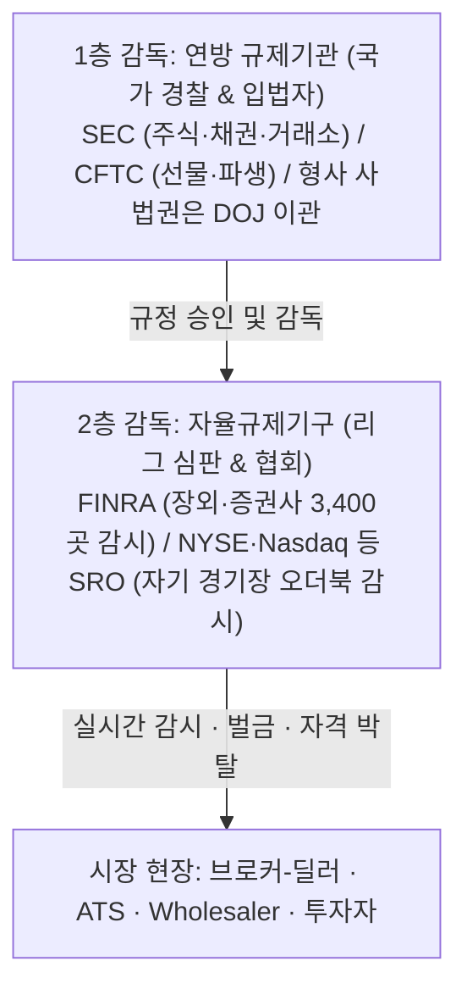

# Chapter 04. 규제기관: 연방 감독기구와 자율규제기구

> **원문 위치**: 파트 II. 시장참여자 > 1. 규제기관 (원문 p.15~16)  
> **이 챕터의 핵심 질문**:
> 1. 미국 자본시장의 '국가 경찰'인 연방 행정기구(`SEC`, `CFTC`)는 어떻게 관할을 나누는가?
> 2. 민간의 자율규제기구(`FINRA`, `SROs`)는 법적으로 어떤 위치에 있으며, 무엇을 감시·처벌할 수 있는가?

---

## 1. 연방정부 내 공공 행정 기구 (`Federal Agency`)

미국 자본시장은 연방정부 내 공공 행정 기구인 독립 규제 기관으로서 증권 전반을 담당하는 **SEC**를 두고 있고, 파생상품시장과 관련하여서는 별도로 **CFTC**를 두고 있습니다.

| 구분 | SEC (`U.S. Securities and Exchange Commission`) | CFTC (`U.S. Commodity Futures Trading Commission`) |
| :--- | :--- | :--- |
| **법적 성격** | Federal Agency (독립 규제 기관) | Federal Agency (독립 규제 기관) |
| **법적 근거** | `Securities Exchange Act of 1934` | `Commodity Exchange Act` |
| **주요 역할** | - 전미 증권 규정 제·개정 (`Rulemaking`) - SRO 규정 변경 최종 승인권 - 사법 집행 (`Civil Enforcement`) | - CME 등 선물거래소 및 `DCO`(청산소) 감독 - `E-mini S&P 500` 등 지수/원자재 선물·스왑 규율 - 파생-현물 크로스 시세조종 단속 |
| **징계/집행 권한** | 민사소송, 과징금, 등록취소, 형사고발 연계 | 민사소송, 포지션 한도 위반 제재, 형사고발 연계 |

> 💡 **원문 팁: `Federal Agency`의 3가지 유형**  
> 미국의 연방 정부 기관(Federal Agency)은 크게 아래 3가지 형태로 존재합니다.
> 1. **내각 부처 (`Cabinet Department`)**: 재무부(Treasury), 법무부(DOJ) 등 대통령 직속 장관 부처
> 2. **독립 규제 기관 (`Independent Regulatory Commissions / Agencies`)**: 정치적 중립성과 전문성을 위해 독립성을 보장받는 위원회·기구  
>    *(예: `FTC`(연방거래위원회), `Fed`(연방준비제도이사회), `SEC`, `CFTC` 등)*
> 3. **정부 기업 (`Government Corporations`)**: 공적 임무를 띤 정부 소유 기업 (예: USPS 우정청, FDIC 예금보험공사 등)

---

## 2. 자율규제 기구 (`Self-Regulatory Organizations`)

미국 자본시장은 연방 기관의 직접 규제 아래, 현장과 가장 가까운 곳에서 실시간으로 시장을 감시하는 **2가지 축의 자율규제 기구**를 두고 있습니다.

| 구분 | FINRA (`Financial Industry Regulatory Authority`) | SROs (`Self-Regulatory Organizations`, 개별 정규 거래소) |
| :--- | :--- | :--- |
| **법적 성격** | 민간 비영리 자율규제기구 | 영리 상장법인 겸 자율규제기관 |
| **법적 근거** | `Exchange Act Section 15A` | `Exchange Act Section 6` |
| **주요 관할** | - **3,400+ 전 브로커-딜러 및 약 60만 영업인력** - 장외(`OTC`, `ATS`, `Wholesaler`) 시장 감시 - `Rule 605 / 606 / 5310(Best Execution)` 집행 | - 자사 오더북(`Order Book`) 실시간 감시 - 회원사 거래소 접속/회선 통제 |
| **징계/집행 권한** | 회원사 제명, 영업정지, 벌금 부과 *(민간 기구이므로 형사권 없음)* | 자사 시장 거래정지, 벌금, 회원 자격 박탈 |

---

## 추가 설명자료: 쉽게 이해하기

### 핵심 용어 사전

| 용어 | 쉬운 풀이 |
| :--- | :--- |
| **SEC** (`Securities and Exchange Commission`) | 1934년 증권거래소법에 따라 설립된 미국 증권시장 최고 감독기관. 주식·채권·ETF·운용사·거래소·FINRA를 총괄 감독합니다. |
| **CFTC** (`Commodity Futures Trading Commission`) | 원유·금 등 원자재뿐만 아니라 **S&P 500 선물, 나스닥 100 선물** 같은 주가지수 선물·스왑 시장을 감독하는 파생상품 전담 연방 규제기관입니다. |
| **DCO** (`Derivatives Clearing Organization`) | 선물·스왑 등 파생상품의 결제를 보증하는 파생상품 전용 청산소 (예: CME Clearing). |
| **FINRA** | 미국 내 모든 브로커-딜러(증권사)와 그 소속 직원들이 의무 가입해야 하는 민간 자율규제 협회. 장외시장(ATS, 도매상)과 브로커의 최선집행(`FINRA Rule 5310`)을 가장 촘촘히 검사합니다. |
| **Civil Enforcement vs 형사고발** | SEC와 CFTC는 스스로 구속·기소(형사권)를 할 수 없습니다. 직접 할 수 있는 것은 연방법원에 **민사소송**을 걸어 거액의 환수·과징금을 물리는 것까지이며, 범죄 혐의(내부자거래 등)가 중대하면 법무부(`DOJ`)와 검찰에 **형사고발을 연계**합니다. |

### 쉬운 비유: "2층 감시탑 구조 — 연방 경찰과 경기장 심판"

미국 시장 감독 체계는 **프로 스포츠 리그와 경찰** 관계에 비유할 수 있습니다.

1. **영리 기업이면서 심판인 SRO의 역설**: 흥미롭게도 NYSE(ICE 자회사)와 Nasdaq은 뉴욕 증시에 상장된 **영리 주식회사**이면서 동시에 법(`Section 6`)에 따라 **자율규제권(`SRO`)**을 행사합니다. 거래소가 영리 목적(수수료 극대화)으로 규정을 자기에게 유리하게 고치는 것을 막기 위해, 거래소가 룰을 하나 바꾸려 해도 반드시 **SEC에 `Form 19b-4`를 내고 최종 승인**을 받아야 합니다.
2. **왜 S&P 500 선물(CME)은 CFTC가, 현물(NYSE)은 SEC가 보나?**: 미국은 역사적으로 농산물 선물 규제에서 출발한 `Commodity Exchange Act` 전통 때문에, 주식을 기초자산으로 하는 **지수 선물**까지도 CFTC가 관할합니다. 그래서 2010년 플래시 크래시처럼 선물(시카고)과 현물(뉴저지)을 넘나드는 시세조종이 터지면 SEC와 CFTC가 공조 수사를 벌이게 됩니다.

### 한국 기관과의 매핑 비교

| 미국 기관 | 대응하는 한국 기관 (유사 기능) | 주요 차이점 |
| :--- | :--- | :--- |
| **SEC + CFTC** | 금융위원회(정책) + 금융감독원(검사·집행) | 한국은 주식·파생 감독이 금융위·금감원으로 통합되어 있으나, 미국은 SEC(증권)와 CFTC(파생)로 분리됨 |
| **FINRA** | 금융투자협회 + 금감원(증권사 검사 일부) | 한국 금투협보다 **FINRA의 검사·제재·장외시장(TRF) 감시 권한이 훨씬 강력**함 |
| **SROs** (`NYSE`, `Nasdaq`) | 한국거래소(`KRX`) 시장감시위원회 | KRX는 공익적 단일/준공적 성격이 강하지만, 미국은 복수 영리 상장거래소 각각이 SRO 지위를 가짐 |
