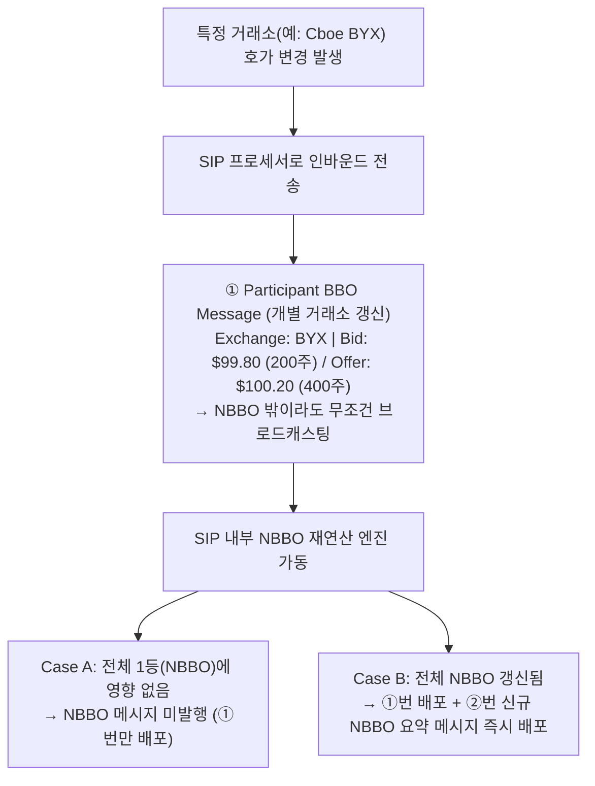
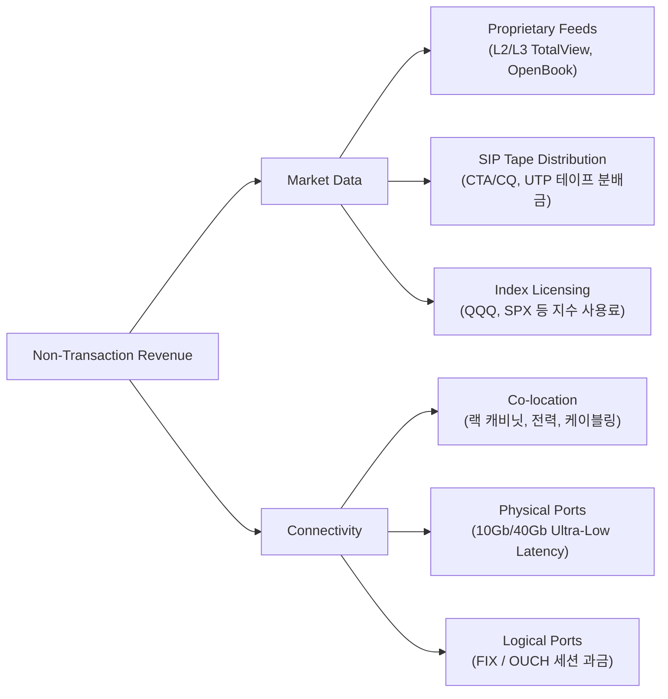

# Chapter 05. 정규 거래소 (National Securities Exchange)

> **원문 위치**: 파트 II. 시장참여자 > 2. 거래소 > 2.1 정규 거래소 (원문 p.17~28)  
> **이 챕터의 핵심 질문**:
> 1. **정규 거래소(Lit Market)**는 무엇이며, `SIP`와 `NBBO`는 구체적으로 어떤 메시지 흐름으로 생성·유통되는가?
> 2. 현재 미국 정규 거래소는 어떤 **4대 그룹(ICE/NYSE, Nasdaq, Cboe, 독립거래소)** 체제로 나뉘는가?
> 3. 거래소는 **상장 독점·거래 체결(Maker-Taker / Inverted / Flat-Fee)·비거래 수익(데이터/코로케이션)**으로 어떻게 돈을 버는가?

---

## 1. 정의 및 특징

미국 자본시장에서 거래소 유형은 규제 지위(`Regulatory Status`), 호가 공개 여부(`Lit vs. Dark`), 매칭 구조 등에 따라 다양하게 구분됩니다. 그중 **정규 거래소(`National Securities Exchange`)**는 `Exchange Act Section 6`에 따라 **SRO 자격**을 보유한 공식 거래소를 말합니다.

### 주요 3대 특징
1. **전국 최우선호가(`NBBO`) 산출 대상 (`Lit Market`)**: 자사의 최우선 매수/도 호가를 **SIP**(`Securities Information Processor`)에 의무적으로 실시간 공시합니다.
2. **Regulation NMS Rule 611 적용**: SIP에서 NBBO로 채택된 최우선 호가는 타 시장에서 `Trade-through`가 제한되어 법적으로 보호(**보호호가; `Protected Quotation`**)를 받습니다.
3. **자율규제 권한**: 자체 시장감시, 상장기준 제정, 회원사 징계 권한 등을 가집니다.

> 💡 **원문 팁: `Lit` vs `Dark`**  
> `'Lit'`은 불이 켜져 환하게 밝혀진(*Lighted / Illuminated*)이라는 은유적 표현입니다. 호가창 내부가 어두워 들여다볼 수 없는 `Dark Pool`에 대비되는 개념으로, 주문 정보와 가격이 시장 전체에 투명하게 공개(**사전 투명성; `Pre-trade transparency`**)되어 있다는 뜻입니다.

---

## 2. SIP와 NBBO 관련 정보의 생성 및 유통 메커니즘

### 2.1 SIP (`Securities Information Processor`) 체계와 MDI Rule

최우선 매수·매도 호가 공표 의무를 갖는 정규 거래소(`Reg NMS Rule 602`) 및 5% 거래량 임계치 초과 규제 대상 ATS(`Reg ATS Rule 301`)들은 `Reg NMS Rule 603`에 따라 자사의 Best Bid and Offer(`BBO`)를 **SIP**에 제출해야 합니다. SIP는 이를 토대로 전국 단일 **NBBO**를 산출해 공표합니다. *(현재 기준은 1단계 최우선 호가 Top-of-Book만 집계·공표)*

- **산출 대상 종목의 상장거래소(자회사 포함)별 SIP 운영 기관**:
  1. **Tape A** (NYSE 상장종목): **SIAC** (NYSE 자회사) 운영
  2. **Tape B** (NYSE Arca, Cboe, Amex 등 상장종목): **SIAC** (NYSE 자회사) 운영
  3. **Tape C** (Nasdaq 상장종목): **Nasdaq** 운영

- **최근 규제 개혁 흐름 (`MDI Rule`: Market Data Infrastructure Rule)**:  
  단일 SIP 체제의 독점 구조와 속도 지연 문제를 해소하기 위해 점진적 전환을 추진하고 있습니다.
  1. **Competing Consolidator Model**: 자격을 갖춘 민간 사업자가 복수 거래소 데이터를 취합해 분배하는 경쟁 체제 도입
  2. **Round Lot 정의 세분화**: 고가 주식에 대해 일괄 100주 기준이던 `Round Lot`을 주가 수준에 따라 **40주, 10주, 1주** 단위로 축소해 NBBO 정밀도 향상
  3. **Depth-of-Book 공개 확대**: 기존 Top-of-Book(1단계)만 제공하던 것에서 **5단계**까지 공개 범위 확대

### 2.2 NBBO 정보 생성·유통의 구체적 아키텍처

> 💡 **원문 팁: 미국 통합 시세망 `SIP (CTA/CQ, UTP)`의 본질**  
> SIP는 단순히 NBBO만 계산해서 쏴주는 계산기가 아니라, 전국 모든 참가 거래소의 톱 오브 북(`Top-of-Book / BBO`) 호가를 하나로 묶어 시장 전체에 분배하는 **통합 시세 배포망(`Consolidated Quotation System`)**입니다.

#### ① 규제적 근거 (`Reg NMS Rule 602 & Rule 603`)
- **Rule 602 (`Quote Rule`)**: 각 정규 거래소는 매칭 엔진에서 형성된 최우선 매수·매도 호가(`BBO`)와 수량을 SIP 프로세서에 의무적으로 실시간 전송합니다.
- **Rule 603 (`Consolidated Regulation`)**: SIP는 수집한 호가 정보를 통합해 지체 없이 공중에 브로드캐스팅해야 합니다. 법률상 SIP의 역할은 *"모든 등록 거래소의 BBO를 모아서 배포하는 것(`Consolidated Quote`)"*이지, 전국 1등 가격(NBBO)만 골라내고 나머지를 버리는 것이 아닙니다.

#### ② SIP 피드의 실제 메시지 처리 구조

실제 SIP(UTP Data Feed / CTA CQ Feed) 스트림에서는 특정 거래소 호가가 바뀔 때마다 두 종류의 메시지가 처리됩니다.

1. **Participant Quote (개별 거래소 BBO 피드)**: 특정 거래소 내부 1등 호가가 바뀌면, 그 가격이 전국 최우선(NBBO)과 한참 떨어져 있더라도 *"해당 거래소의 BBO가 갱신되었다"*는 메시지가 실시간 브로드캐스팅됩니다.
2. **NBBO Quote (전국 최우선 호가 연산 메시지)**: SIP는 개별 거래소 호가를 반영해 내부 상태 테이블을 업데이트한 뒤, 전국 1등 가격이나 수량이 변했을 때만 별도의 NBBO 갱신 메시지를 트리거합니다.

#### ③ NBBO가 아닌 호가도 실시간 브로드캐스팅해야 하는 실무적 이유 2가지
1. **스마트 오더 라우터(`SOR`)의 차순위 호가(`Depth-of-Book`) 재구성**:  
   5,000주를 시장가로 체결하려 할 때 최우선 호가(NBBO) 수량이 1,000주뿐이라면 나머지 4,000주는 차순위 가격에서 체결되어야 합니다. 브로커의 SOR은 SIP가 보내주는 각 거래소별 BBO를 모아 가상의 **전국 뎁스(`Consolidated Depth`)**를 직접 조립합니다. *(예: `A거래소($100.00 / 1,000주, NBBO) → B거래소($99.95 / 2,000주) → C거래소($99.90 / 2,000주)`)*
2. **락/크로스 마켓(`Locked/Crossed Markets`) 모니터링 및 감시**:  
   `Reg NMS Rule 610`은 거래소 간 호가가 꼬여 매수가가 타 거래소 매도가보다 높거나 같아지는 상태를 엄격히 금지합니다. FINRA와 거래소 감시 시스템은 모든 거래소의 BBO 스트림을 모니터링해 누가 락/크로스를 유발했는지 실시간 추적합니다.

#### ④ 여러 거래소가 동일한 최우선 가격을 제시할 때 (`Tied Quote`) 데이터 처리 3계층
1. **SIP의 단일 BBO 레코드 (`Consolidated BBO`)**:  
   전통적 SIP BBO 메시지 레이아웃은 단 하나의 `NBB`와 `NBO` 슬롯만 가집니다. Nasdaq, NYSE, Cboe가 모두 `$100.00`을 제시한 **Tied Quote**가 발생하면, **우선순위 표기**(가장 먼저 제시한 `Time Priority` 거래소의 Participant ID를 대표로 찍음)와 **통합 수량 표기**(동호가 거래소들의 수량을 합산한 `Aggregate Size`)만 담깁니다. 즉, 요약 메시지 한 줄만으로는 거래소별 쪼개진 수량이 보이지 않습니다.
2. **SIP의 개별 거래소 호가 스트림 (`Quote Feed: CTA Plan A/B, UTP`)**:  
   SIP는 각 거래소의 BBO 업데이트 전문(`Nasdaq Bid $100.00 200주`, `NYSE Bid $100.00 300주`, `Cboe BZX Bid $100.00 100주`)을 실시간 브로드캐스팅합니다. 브로커의 시세 수신 엔진(`Ticker Plant`)은 이를 받아 로컬 메모리에 **거래소별 BBO 테이블(`Consolidated Montage`)**을 빌드해 각 거래소별 개별 잔량을 분리 인식합니다.
3. **증권사/HFT의 직접 시세망 (`Proprietary Direct Feeds`)**:  
   레이턴시에 민감한 기관과 SOR은 수 밀리초 지연이 발생하는 SIP 대신 각 거래소 독자 피드(`Nasdaq TotalView`, `NYSE Integrated Feed` 등)를 직접 받아 자체 NBBO 테이블을 연산(**`Synthetic NBBO`**)하고, 마이크로초 단위로 분할 라우팅(`Order Sweeping`)을 수행합니다.

> 📝 **원문 노트: `Trade-through 금지` 요약 (`Reg NMS Rule 611`)**  
> 타 거래소에 더 좋은 우선호가가 있음에도 NBBO보다 불리한 조건으로 자사 거래소에서 체결하는 것을 금지합니다. 이 경우 거래소는 호가 옵션에 따라 ① NBBO 보유 거래소로 주문을 Routing 하거나, ② 취소하거나, ③ 조정(NBBO보다 열위가 되도록 가격 조정)해 공표해야 합니다. 단, 주문자가 **ISO**로 제출했거나 특정 거래소의 심각한 시스템 장애로 지연된 경우에는 예외적으로 자체 거래소에서 체결(`Trade-through`)할 수 있습니다.

---

## 3. 정규 거래소 현황

현재 미국 정규 거래소는 사실상 **3개 그룹(NYSE, Nasdaq, Cboe)** 중심의 경쟁 체제 + 독립 거래소들로 구성되어 있습니다.

### 표 2-1. 미국 주요 정규거래소 현황

| 거래소 그룹 | 보유 거래소 라이선스 (`MIC`) | 주력 포지셔닝 및 비즈니스 모델 |
| :--- | :--- | :--- |
| **ICE / NYSE Group** | - `NYSE` (`XNYS`) - `NYSE Arca` (`ARCX`) - `NYSE American` (`XASE`) - `NYSE National` (`XCIS`) - `NYSE Chicago` (`XCHI`) | - **XNYS**: 전통 블루칩 및 SPAC 상장, `DMM` 기반 Floor/전자 결합 시장 - **ARCX**: 미국 최대 `ETP(ETF)` 상장 및 거래 중심 엔진 - **XASE**: 중소형 성장 기업(과거 AMEX) 및 소형 SPAC 상장 - **National/Chicago**: 저수수료 테이커 유치용 서브 엔진 |
| **Nasdaq Group** | - `Nasdaq` (`XNAS`) - `Nasdaq BX` (`XBOS`) - `Nasdaq PSX` (`XPHL`) | - **XNAS**: 테크/혁신/바이오/글로벌IT 및 ETF 상장, 대표 **메이커-테이커** 마켓 - **BX**: **인버티드(`Taker-Maker`)** 모델 - **PSX**: 가격-수량 우선 배분(`Price-Size Priority`) 실험 마켓 |
| **Cboe Global Markets** | - `Cboe BZX` (`BATS`) - `Cboe BYX` (`BATY`) - `Cboe EDGA` (`EDGA`) - `Cboe EDGX` (`EDGX`) | - BATS 및 Direct Edge 인수로 구축된 멀티 북 라인업 - **BATS**: ETP/ETF 전문 상장 - **BZX/EDGX**: 표준 메이커-테이커 및 ETP 거래 - **BYX/EDGA**: 인버티드 및 쿼트 디스플레이 실험 모델 - 독점 지수 옵션(`SPX`, `VIX`)과의 현·선물 연계 시너지 |
| **독립 거래소 (Independent)** | - `IEX` (`IEXG`) - `MEMX` (`MEMX`) - `MIAX Pearl Equities` | - **IEX**: 350마이크로초 물리 지연(`Speed Bump`) 코일을 통한 HFT 레이턴시 아비트라지 방어 - **MEMX**: 월가 대형 브로커/마켓메이커 컨소시엄이 기존 거래소의 시세·회선비 인하를 압박하기 위해 설립 |

---

## 4. 정규 거래소의 수익 모델

### 4.1 상장 거래소 (`Prime Listing Venues`) 추가 수익

정규 거래소가 상장 기능을 수행하면 일반 거래 수익 외에 독점적 수익을 추가로 창출합니다.

1. **상장 수수료 (`Listing Fees`)**: 신규 상장(IPO) 시 일회성 `Initial Listing Fee` + 시가총액·발행주식수 기반 매년 징수하는 `Annual Fee`.
2. **단일가 체결 독점 수수료**: 시가(`Opening Price`), 종가(`Closing Price`), `MWCB` 및 `LULD` 가격안정화를 위한 단일가 체결은 **상장거래소(`Prime Listing Venue`)에서만 독점 진행**됩니다.  
   → 특히 `Closing Cross`에는 대규모 패시브 ETF(S&P 500, Nasdaq 100 등)의 리밸런싱 주문(`MOC`, `LOC`)이 집중되며, 연속매매 대비 체결 수수료(**주당 약 `$0.0010~$0.0016` / `1.0~1.6밀`**)가 높고 볼륨이 방대해 막대한 마진을 창출합니다.

> 💡 **원문 팁: 단일가 체결 독점 3대 영역**  
> 1. **Opening / Closing Price 결정**: 상장거래소에서만 독점 진행되나, 동 시간 동안 타 거래소/ATS에서는 시·종가 결정과 무관하게 **접속체결이 중단 없이 지속**됩니다.  
> 2. **LULD Auction**: SIP가 직전 5분 거래량 가중평균가격(`Reference Price`) 기반 LULD 밴드를 산출·공표하고, `NBO`가 `LD`에 도달하거나 `NBB`가 `LU`에 도달해 **15초간 유지**되면 `LULD Halt`가 발동됩니다. 이후 **5분간** 상장거래소에서 단일가 호가를 받아 5분 종료 시점에 단일가 체결을 실시합니다. *(이 시간 동안 타 Trading Venue 거래는 전면 정지, Auction 완료 후 새 LULD 공표 시 재개)*  
> 3. **MWCB 정지 및 Auction**: `S&P 500` 지수 기준으로 **NYSE**가 판단해 **1단계(7% 하락), 2단계(13% 하락), 3단계(20% 하락)** 발동 여부를 공표합니다. 1/2단계 발동 시 **15분간** 상장거래소에서 호가를 받아 15분 종료 시점에 단일가 체결을 실시합니다. *(동 시간 타 Trading Venue 거래 정지, 단일가 체결과 동시에 재개)*

#### 표 2-2. 미국 주요 상장 거래소 현황

| 거래소 그룹 | 공식 상장 거래소 | MIC 코드 | 주력 상장 자산 및 타깃 기업군 | 대표 상장 사례 |
| :--- | :--- | :--- | :--- | :--- |
| **ICE / NYSE Group** | New York Stock Exchange (`NYSE`) | `XNYS` | 대형 전통 블루칩, 산업재, 금융, 글로벌 초대형 기업, SPAC | 버크셔 해서웨이, JP모건, TSMC(ADR) |
| | `NYSE American` | `XASE` | 중소형 성장 기업(과거 AMEX), 소형 SPAC | 바이오테크, 소형 자원·에너지주 |
| | `NYSE Arca` | `ARCX` | ETP / ETF 전문 상장 (글로벌 1위 ETF 상장 시장) | SPY, VOO, 비트코인 현물 ETF |
| **Nasdaq Group** | `The Nasdaq Stock Market` | `XNAS` | 테크, 혁신·바이오 기업, 글로벌 IT 기업, ETP | 애플, 마이크로소프트, 엔비디아, QQQ |
| **Cboe Global Markets** | `Cboe BZX Exchange` | `BATS` | ETP / ETF 전문 상장 (수수료 경쟁력 기반 유치) | 주요 테마형 ETF, 신규 현물 암호화폐 ETF |
| **독립 거래소** | `IEX` (Investors Exchange) | `IEXG` | 상장 규정(Rule)은 보유 중이나 실질적 상장 기업 전무 | 과거 기업 이전 유치 시도 후 사실상 중단 |

### 4.2 거래 체결 수익 (`Transaction Revenue`)

정규 거래소는 먼저 공식 마켓메이커(`DMM`, `SLP`, `QMM`, `LMM`)와의 규정 기반 계약을 통해 장 시작 전부터 최소 스프레드 유동성(**기저 유동성; `Baseline NBBO`**)을 깔아둡니다. 이들에게는 최상단 `Maker Rebate + 애드온 리베이트`, 옥션 수수료 면제, 포트 접속료 감면 등 파격적 우대를 제공합니다. 그 위에서 거래소는 3가지 가격 모델로 외부 주문을 흡수합니다.

#### Type 1: 메이커-테이커 (`Maker-Taker`) 거래소
- **대표 거래소**: `Nasdaq`(기본 Tape), `NYSE`, `Cboe BZX`, `MEMX`
- **메커니즘**: 유동성 공급 지정가(`Maker`)에 **Rebate(환급)** 지급, 대기 물량 체결 시장가(`Taker`)에 **Fee(수수료)** 부과
- **수익 공식**: $\text{Net Capture} = \text{Take Fee} - \text{Maker Rebate}$
- **수수료 한도 (`Rule 610(c)`)**: `$1` 이상 주식 `Take Fee` 법정 상한 주당 `$0.0030` (`3밀` = 100주당 30센트). 통상 Taker에게 약 `3밀($0.0030/주)` 부과하고 Maker에게 `2.0~2.9밀($0.0020~$0.0029/주)` 환급해 주당 **`0.1~1.0밀`($0.0001~$0.0010)** 순스프레드 마진 확보.
- **Tiered Pricing (거래량 연동 구간제)**: 일평균 거래량(`ADAV`, `ADV`)이 설정 Tier를 넘을수록 높은 Rebate를 주어 고객을 락인(`Lock-in`).

#### Type 2: 인버티드 (`Inverted / Taker-Maker`) 거래소
- **대표 거래소**: `Nasdaq BX`, `Cboe BYX`, `EDGA`
- **메커니즘**: 유동성 제거자(`Taker`)에게 **Rebate(또는 무료)**를 주고, 유동성 공급자(`Maker`)에게 **Fee** 부과 (역방향 모델)
- **수익 공식**: $\text{Net Capture} = \text{Maker Fee} - \text{Taker Rebate}$

> 📝 **원문 노트: Inverted 거래소에 누가, 왜 Maker 호가를 제출하는가?**  
> 수수료를 내면서까지 NBBO 가격으로 Maker 호가를 내는 이유는 **빠른 체결 우선순위(Fill Priority) 확보 및 역선택·기회비용 최소화** 때문입니다.
> 1. **짧은 대기열**: 리베이트를 노린 MM 물량이 몰려 있는 Maker-Taker 거래소와 달리, Inverted 거래소는 Maker에게 수수료를 물리기 때문에 **대기열(Queue)이 훨씬 짧습니다.**
> 2. **Taker 주문의 1순위 타깃**: 수수료를 아끼려는(혹은 리베이트를 받으려는) 타방 Taker 주문은 Maker-Taker보다 **Taker-Maker 거래소로 우선 라우팅**됩니다.
> 3. **결론**: 빠른 체결을 원하지만 시장가 주문으로 스프레드 손실을 보기는 싫은 알고리즘 트레이더는 수수료를 내고서라도 Inverted 거래소 맨 앞줄에 서서 가장 먼저 체결시킵니다.

#### Type 3: 플랫 피 / 지연 장치 (`Flat-Fee / Speed-Bump`) 거래소
- **대표 거래소**: `IEX` (Investors Exchange), `LTSE`, `NYSE National`
- **메커니즘 (단일 고정 요율)**: 메이커/테이커 구분 없이 체결 주당 단일 요율 징수 *(예: IEX 비표시 주문 주당 `$0.0009` / `0.9밀` 등)*. 리베이트 지급이 없어 체결량 전체에서 안정적 순수익 마진 확보.
- **수익 공식**: $\text{Net Capture} = \text{Maker Fee} + \text{Taker Fee}$
- **특징**: 물리적 광섬유 코일(**38마일, 350마이크로초 지연**)이나 알고리즘(**CQI**: *Crumbling Quote Indicator*)으로 HFT의 레이턴시 아비트라지를 억제해 대형 기관 주문의 시장 충격을 줄여줍니다.

### 4.3 비거래 수익 (`Non-Transaction Revenue`)

현대 대형 거래소 그룹(`ICE/NYSE`, `Nasdaq`, `Cboe`)의 영업이익에서 **거래 수수료보다 더 큰 비중을 차지하는 핵심 캐시카우**입니다.

| 수익 항목 | 과금 방식 및 세부 메커니즘 | 주요 특징 및 진입장벽 |
| :--- | :--- | :--- |
| **자체 마켓 데이터** (`Proprietary Data`) | 월간 정액 라이선스 (단말기/유저/엔터프라이즈 단위 과금) | 거래소 오더북 전체 뎁스(`L2/L3`, Depth-of-Book) 제공 (`Nasdaq TotalView`, `NYSE Integrated Feed`). 알고리즘 트레이더 필수재 |
| **SIP 테이프 분배금** (`SIP Revenue`) | `Reg NMS Rule 603` 공식 통합 시세 수익 정산 | `CTA/CQ (Tape A/B)`, `UTP (Tape C)` 판매 수익을 각 거래소의 최우선 호가 표출(`Quoting`) 및 체결(`Trading`) 점유율 공식에 따라 배분 |
| **인프라 코로케이션** (`Co-location`) | 데이터센터 공간 및 전력당 월정액 렌탈 | 거래소 매칭 엔진이 있는 데이터센터(**NJ Mahwah, Carteret, Secaucus**) 내 랙 임대. 밀리초 이하 지연 단축 경쟁 활용 |
| **포트 접속료** (`Port Fees`) | 물리적 라인(`Cross-Connect`) 및 논리적 세션(`Port`)당 월 과금 | `10G/40G` 파이버 포트, 주문 제출 세션(`OUCH`, `FIX` 포트), 시세 수신용 `ITCH` 포트 등 접속 개수당 월 수천 달러씩 고정 징수 |
| **인덱스 및 라이선싱** (`Index & IP`) | AUM 비례 라이선스 수수료 및 파생상품 독점권 | 거래소 산하 지수(`Nasdaq 100` 등) 추종 ETF의 운용자산(`AUM`) 비례 과금 및 지수 옵션 독점 상장 계약 수수료 |

---

## 5. 정규 거래소별 수익 구조 현황 (2024년)

### 표 2-3. 전사 순영업수익(`Consolidated Net Revenue`) 기준 4사 비교

| 구분 | ICE (`NYSE Group`) | `Nasdaq, Inc.` | `Cboe Global Markets` | `IEX` |
| :--- | :--- | :--- | :--- | :--- |
| **전사 순영업수익** (`Net Revenue`) | 약 `$9.5B ~ $10.0B` (100%) | 약 `$4.2B ~ $4.5B` (100%) | 약 `$1.9B ~ $2.1B` (100%) | 약 `$0.10B ~ $0.12B` (100%) |
| **① 주식 순거래 체결** (`Cash Equities Net`) | 약 `9 ~ 10%` (`~$0.85B`) | 약 `20 ~ 22%` (`~$0.90B`) | 약 `6 ~ 8%` (`~$0.14B`) | 약 `75 ~ 80%` (`~$0.09B`) |
| **② 파생/선물 순체결** (`Derivatives/Futures`) | 약 `20 ~ 22%` (`~$2.0B`, 브렌트유/천연가스) | 약 `10 ~ 11%` (`~$0.45B`, 주식/지수 옵션) | 약 `55 ~ 58%` (`~$1.15B`, SPX/VIX 독점) | `0%` (`$0`) |
| **③ 마켓 데이터** (`Data Services & SIP`) | 약 `24 ~ 25%` (`~$2.4B`, ICE Data) | 약 `25 ~ 26%` (`~$1.10B`, TotalView 등) | 약 `16 ~ 17%` (`~$0.34B`, Cboe Data) | 약 `8 ~ 10%` (`~$0.01B`) |
| **④ 접속/코로케이션** (`Connectivity/Ports`) | 약 `6 ~ 7%` (`~$0.62B`, Mahwah) | 약 `9 ~ 10%` (`~$0.43B`, Carteret) | 약 `9 ~ 10%` (`~$0.19B`, Secaucus) | 약 `12 ~ 15%` (`~$0.015B`) |
| **⑤ 기업 상장 수수료** (`Listings`) | 약 `5 ~ 6%` (`~$0.50B`, NYSE 본장) | 약 `10%` (`~$0.45B`, Nasdaq 본장) | `< 0.5%` (`~$0.01B` 미만) | `0%` (`$0`) |
| **⑥ 비거래 특화 사업** (`SaaS / Mortgage / FX`) | 약 `21 ~ 23%` (`~$2.1B`, Black Knight 등) | 약 `16 ~ 18%` (`~$0.75B`, Verafin 등) | 약 `7 ~ 8%` (`~$0.15B`, FX 등) | `0%` (`$0`) |

### 표 2-4. 주식거래소 사업부 기준 4사 비교

| 수익 항목 | ICE (`NYSE Group` 주식) | `Nasdaq, Inc.` (Nasdaq 주식) | `Cboe` (Cboe 주식 4개사) | `IEX` |
| :--- | :--- | :--- | :--- | :--- |
| **사업부 합산 모수** (`Net Base`) | 약 `$2.8B` (100%) | 약 `$2.5B` (100%) | 약 `$0.42B` (100%) | 약 `$0.11B ($110M)` (100%) |
| **① 주식 순거래 체결** (`Net Cash Trading`) | 약 `30%` (`~$0.85B`) | 약 `36%` (`~$0.90B`) | 약 `33%` (`~$0.14B`) | 약 `78%` (`~$0.086B`) |
| **② 자체 마켓 데이터** (`Data & SIP`) | 약 `28%` (`~$0.78B`) | 약 `29%` (`~$0.73B`) | 약 `38%` (`~$0.16B`) | 약 `9%` (`~$0.010B`) |
| **③ 접속료 및 포트** (`Connectivity/Ports`) | 약 `22%` (`~$0.62B`) | 약 `17%` (`~$0.43B`) | 약 `27%` (`~$0.11B`) | 약 `13%` (`~$0.014B`) |
| **④ 기업 상장 유지/신규 수수료** | 약 `18%` (`~$0.50B`) | 약 `18%` (`~$0.45B`) | `< 2%` (`~$0.01B` 미만) | `0%` (`$0`) |
| **⑤ 인덱스 및 기타** | 약 `2%` (`~$0.05B`) | 약 `0%` | 약 `0%` | `0%` (`$0`) |

---

## 추가 설명자료: 쉽게 이해하기

### 핵심 용어 사전

| 용어 | 쉬운 풀이 |
| :--- | :--- |
| **MIC** (`Market Identifier Code`) | ISO 10383 국제 표준에 따라 전 세계 거래소·시장을 식별하는 4자리 영문 코드 (`XNYS`=NYSE, `XNAS`=Nasdaq 등). |
| **Top-of-Book / BBO** | 호가창 전체(1~10호가 등) 중 가장 가격이 좋은 **최우선 매수 1호가 & 최우선 매도 1호가**만을 뜻합니다. |
| **DMM / SLP / QMM / LMM** | 거래소와 정식 계약을 맺고 의무적으로 호가를 깔아주는 지정 마켓메이커들 (`Designated / Supplemental Liquidity Provider / Lead Market Maker` 등). |
| **CQI** (`Crumbling Quote Indicator`) | IEX가 개발한 AI/신호 기반 보호 장치. *"방금 시세가 급변해 기존 매도/매수 호가가 곧 먹힐(무너질) 찰나"*임을 탐지하면 HFT의 추격 매매로부터 일반 주문을 잠시 보호합니다. |

### 쉬운 숫자 예시: Maker-Taker vs Inverted 1,000주 거래 정산

어떤 투자자가 `$100.00` 주식을 **1,000주** 거래한다고 가정해 봅시다.
1. **Maker-Taker 거래소 (예: Nasdaq)**
   - **Taker(시장가 주문)**: `$0.0030/주` 수수료 지불 → **`-$3.00` 지출**
   - **Maker(지정가 대기)**: `$0.0025/주` 리베이트 수취 → **`+$2.50` 수익**
   - **거래소 순마진(`Net Capture`)**: `$3.00 - $2.50` = **`+$0.50`** (`0.5밀/주`)
2. **Inverted 거래소 (예: Nasdaq BX)**
   - **Maker(지정가 대기)**: `$0.0020/주` 수수료 지불 → **`-$2.00` 지출** (단, 줄이 짧아 훨씬 빨리 체결!)
   - **Taker(시장가 주문)**: `$0.0015/주` 리베이트 수취 → **`+$1.50` 수익**
   - **거래소 순마진(`Net Capture`)**: `$2.00 - $1.50` = **`+$0.50`**

→ **핵심 인사이트**: 거래소는 두 모델 모두에서 주당 `0.5밀`씩 벌지만, 시장 참여자들은 "시간이 급한지(Taker)" vs "안전한 빠른 체결이 급한지(Maker)"에 따라 정반대 거래소를 선택합니다!

### 실무 인사이트: "거래소는 IT·데이터 부동산 사업자"
표 2-4를 보면 충격적인 사실이 드러납니다. `ICE(NYSE)`와 `Nasdaq`의 주식사업부조차 **순거래 체결 수익은 30~36%에 불과**하며, 나머지 **64~70%가 데이터 판매, 뉴저지 데이터센터 랙 임대(코로케이션), 광통신 포트 접속료, 상장 수수료**라는 사실상 **고정 구독료(SaaS) 및 데이터센터 부동산**에서 나옵니다! (반면 IEX는 데이터·상장 매출이 작아 거래 수수료 비중이 78%에 달합니다.)
