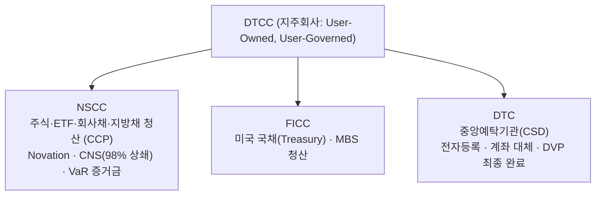

# Chapter 07. 청산결제 기관(DTCC)과 시장 회원

> **원문 위치**: 파트 II. 시장참여자 > 3. 청산결제 기관 & 4. 회원 (원문 p.34~38)  
> **이 챕터의 핵심 질문**:
> 1. 거래가 체결된 뒤 실제 주식과 현금은 어떤 기관(`DTCC` 산하 `NSCC · FICC · DTC`)을 거쳐 안전하게 오가는가?
> 2. 거래소의 핵심 회원 유형(`Broker`, `Dealer`, `복합형`)과 ATS의 회원 선별 권한은 어떻게 다른가?
> 3. 모든 증권사가 직접 청산소에 접속하는가? (`GCM`, `DCM`, `NCM`의 역할 분담)

---

## 1. 청산결제 기관: DTCC (`Depository Trust & Clearing Corporation`)

### 1.1 설립 배경과 지배구조
- **법적 성격**: 월가의 주요 금융기관(브로커-딜러, 은행, 뮤추얼 펀드 등)이 지분을 분산 소유하고 있는 **민간 지주회사 (`User-Owned, User-Governed`)**입니다.
- **설립 배경**: 1960년대 말 종이 실물 증권 처리 지연으로 수백 개 증권사가 파산한 **'서류 위기(`Paperwork Crisis`)'**를 계기로 결제 인프라를 중앙화·전자화하기 위해 설립되었습니다.
- **지배구조**: 핵심 자회사로 **NSCC**, **FICC**, **DTC** 3사를 두고 있습니다.

### 1.2 NSCC (`National Securities Clearing Corporation`)
주식, ETF, 회사채, 지방채에 대한 청산 업무를 담당하며 SEC의 규제를 받습니다. **중앙청산소(`CCP`; Central Counter Party)**로서 다음 3대 핵심 기능을 수행합니다.

1. **Novation (채무인수)**:
   - 과거에는 `T+1`일 새벽에 채무인수가 이루어졌으나, 시스템 고도화 이후 **거래일(T일) 체결 데이터가 유효하게 보고·대사(`Comparison/Matching`)되는 즉시(`Trade Date`)** 채무인수가 발동됩니다.
   - 체결 즉시 매수자에게는 매도자가 되고 매도자에게는 매수자가 되어, 특정 증권사(예: 리먼 브라더스)가 결제 전 파산하더라도 전체 시장의 결제 이행을 **100% 보증**합니다.
2. **CNS (`Continuous Net Settlement`, 연속 다자간 차감)**:
   - 복수 거래소와 장외(`TRF`)에서 발생한 모든 거래를 합산 상계합니다.
   - 통상 일일 체결 건수의 **98% 이상이 CNS를 통해 상계되어 상쇄**되며, 실제로 결제일에 DTC 장부상으로 증권이 이동하고 현금이 오가는 규모는 **전체 거래량의 2% 수준**에 불과합니다.
   - 만약 특정 증권사가 결제일에 주식을 인도하지 못해 **Fail(`Fail to Deliver`)**이 발생하더라도, 계약을 파기하지 않고 다음 날의 CNS 포지션으로 자동 롤오버(**`Fail Netting`**)하여 결제 큐를 유지합니다.
3. **리스크 관리 (`Clearing Fund / VaR 마진`)**:
   - 회원사별 미결제 포지션(`Unsettled Trades`)의 잠재 손실을 방어하기 위해 **모수적 VaR(`Value at Risk`) 모델**을 기반으로 **일일 2회 이상 증거금(`Clearing Fund`)**을 산출·징수합니다.
   - 특정 회원사의 포지션이 단기간에 비정상적으로 급증해 자기자본 대비 노출 위험이 과도해질 경우, NSCC는 **징벌적 성격의 추가 마진**을 즉시 요구합니다.

### 1.3 FICC (`Fixed Income Clearing Corp`)
미국 국채(`Treasury`) 및 모기지 유동화 증권(`MBS`)에 대한 청산 업무를 담당하는 기관입니다.

### 1.4 DTC (`The Depository Trust Company`)
유가증권의 예탁 및 장부상 소유권 이전을 담당하며 SEC, 연준(Fed), 뉴욕주 금융청의 규제를 받습니다. **중앙예탁기관(`CSD`; Central Securities Depository)**으로서 실물증권의 비물질화/전자 등록, 계좌 대체(`Book-entry Transfer`), **증권-대금 동시결제(`DVP`; Delivery Versus Payment)** 최종 완료 등을 수행합니다.

---

## 2. 시장 회원 (`Members`)

### 2.1 거래소 회원

#### 정규 거래소 회원의 자격 (`Fair Access`)
- 정규 거래소는 공공 인프라이므로 법적·재무적 자격을 갖춘 Broker-Dealer의 회원 가입을 자의적으로 거부할 수 없습니다.

> 💡 **원문 팁: 시장 `Player`의 3가지 유형**  
> 1. **Broker (`Agency`)**: 기관/개인 고객의 주문을 수탁받아 거래소에 주문을 대행 제출하는 참여자(위탁 주문). 주문 플래그: `Agency`  
>    *(주요 사례: `Instinet`, 대형 증권사 기관영업 데스크)*  
> 2. **Dealer (`Principal`)**: 자기 자본으로 호가를 제출하는 참여자(자기 주문). 주문 플래그: `Principal`  
>    *(주요 사례: `Citadel Securities`, `Virtu`, `Jane Street`)*  
> 3. **복합형**: Broker와 Dealer 역할을 모두 수행하는 참여자. 고객 주문 중개와 자기자본 트레이딩 사이에 물리적·전산적 **차이니즈 월(`Information Barrier`)**을 두어야 합니다.  
>    *(주요 사례: `Morgan Stanley`, `Goldman Sachs`, `JPMorgan`)*

#### ATS 회원의 자격
- 시장 점유율 **5% 미만**인 대다수 ATS는 운영자가 자체 기준에 따라 참가자(`Subscriber`)를 선별·배제할 수 있습니다.
  - 예: 기관 전용 다크풀(`Liquidnet` 등)은 *"우리는 장기 기관 투자자만 받고, 초단타 매매(HFT)나 Prop Firm은 가입을 불허한다"*는 배타적 회원제 운영이 가능합니다.
  - 또한 가입자들을 **주문 독성(`Toxicity`)**에 따라 등급(`Tier`)으로 나누고, 특정 가입자 그룹 간에만 호가가 매칭되도록 **오더북 세그멘테이션**을 적용합니다.

> 📝 **원문 노트: `Regulation ATS Rule 301(b)(5)`**  
> **5% 거래량 임계치 규제 대상**에 해당하는 경우에는 ATS에도 **Fair Access Rule (`Rule 301(b)(5)`)**이 적용되어 객관적 자격을 갖춘 브로커-딜러의 가입을 배제할 수 없습니다.

---

### 2.2 청산소 회원 (`GCM` · `DCM` · `NCM`)

| 구분 | **GCM** (`General Clearing Member`, 종합청산회원) | **DCM** (`Direct Clearing Member`, 직접청산회원) | **NCM** (`Non-Clearing Member`, 비청산회원) |
| :--- | :--- | :--- | :--- |
| **미국 시장 내 용어** | `Clearing Broker` / `Carrying Broker` | `Self-Clearing Member` | `Introducing Broker` |
| **대표 회사** | - `Apex Clearing`, `Pershing`(BNY Mellon) - `National Financial Services`(Fidelity) - `BNP Paribas`, `JPMorgan`, `Goldman Sachs` - `ABN AMRO Clearing`, `BofA Securities` | - `Robinhood Securities` - `Vanguard` | *(자체 청산 권한 없는 중소 브로커·프랍펌 등)* |
| **청산소(CCP) 직결 여부** | **직접 결제** (`Direct Participant`) | **직접 결제** (`Direct Participant`) | **간접 결제** (`Indirect / Client`) |
| **자기/자사 고객 계정 청산** | 가능 | 가능 | **불가** (청산 권한 없음) |
| **타사(NCM/타 브로커) 대행 청산** | **가능** (`Third-Party Clearing`) | **불가** (`Self-Clearing Only`) | 해당 없음 |
| **자본금 요건 (`Net Capital`)** | **가장 엄격** (수억 달러~수조 원 단위) | 중간 수준 (자사 리스크 감당 수준) | 거래소 회원 요건만 충족 |
| **CCP 디폴트 워터폴 기여** | 디폴트 펀드 기본 분담금 + 타사 대행분 비례 추가 납부 | 자사 거래 규모에 비례한 디폴트 펀드 납부 | 청산소 담보 직접 납부 의무 없음 (**GCM에 증거금 납부**) |
| **주요 사업 모델** | 글로벌 프라임 브로커(`PB`), 전문 청산 대행사 (`Custody/Clearing IB`) | 자기매매 전문 대형 HFT, 자사 리테일만 소화하는 대형 증권사 | 중소형 브로커, 독립 프랍 트레이딩 펌(`Prop Firm`) |

---

## 추가 설명자료: 쉽게 이해하기

### 핵심 용어 사전

| 용어 | 쉬운 풀이 |
| :--- | :--- |
| **CCP** (`Central Counter Party`) | 매도자와 매수자 사이에 끼어들어 양쪽의 계약 상대방이 되어주는 중앙청산소(예: NSCC). 상대 증권사가 망해도 결제를 책임집니다. |
| **DVP** (`Delivery Versus Payment`) | 주식을 주는 순간 대금을 받고, 대금을 주는 순간 주식을 받아 결제 불이행("돈만 주고 주식을 못 받는") 위험을 없애는 동시결제 원칙. |
| **Chinese Wall** | 증권사 내부에서 고객 주문 정보(브로커 부서)가 자기자본 매매(딜러 부서)에 흘러가 선행매매에 악용되지 않도록 막는 정보 차단벽. |
| **Default Waterfall** | 청산회원이 파산했을 때 손실을 메우는 순서(파산 회원의 증거금 → 파산 회원의 디폴트 펀드 → 청산소 자기자본 → 생존 회원들의 공동 디폴트 펀드 순). |

### 쉬운 숫자 예시: CNS가 거래량 98%를 없애는 마법
하루 동안 A, B, C 세 증권사가 애플(AAPL) 주식을 사고팔았다고 가정해 봅시다.
- A → B에게 `1,000주` 매수
- B → C에게 `1,000주` 매수
- C → A에게 `950주` 매수
- C → B에게 `50주` 매수  
*(총 거래 체결량 = `3,000주`)*

만약 거래 건마다 일일이 주식과 돈을 주고받으면 3,000주 분량의 현금과 주식이 오가야 하지만, **NSCC의 CNS(연속 다자간 차감)**가 하루치 모든 매수와 매도를 합산하면:
- **A**: `+1,000 - 950 = +50주` 순매수
- **B**: `-1,000 + 1,000 - 50 = -50주` 순매도
- **C**: `-1,000 + 950 + 50 = 0주` (순이동 없음!)  

결과적으로 **3,000주가 거래되었지만 실제로 장부(DTC)에서 이동하는 주식은 단 50주(약 1.7%)**뿐입니다!

### 실전 연결: 2021년 게임스톱(GME) 사태와 NSCC 마진 콜
로빈후드(`Robinhood Securities`)는 자기 고객의 청산만 처리하는 **DCM(`Self-Clearing Member`)**입니다. 2021년 초 게임스톱 주가가 폭등·폭락하자, 미결제 기간(`당시 T+2`) 동안의 잠재 손실 위험이 치솟아 **NSCC가 VaR 모델에 따라 로빈후드에 수십억 달러의 긴급 추가 증거금(Clearing Fund)을 요구**했습니다. 자금이 부족했던 로빈후드가 매수 버튼을 일시 제한했던 사건이 바로 이 챕터의 **NSCC 리스크 관리 규정**이 현실에서 작동한 대표 사례입니다!

### 한국 시장(KRX · KSD)과의 비교
- 한국에서는 **한국거래소(KRX)**가 매매 체결뿐 아니라 청산(`CCP`, 채무인수 및 차감)까지 맡고, **한국예탁결제원(KSD)**이 증권 예탁 및 최종 결제를 분담합니다.
- 반면 미국은 16개 거래소·40개 ATS가 거래만 하고, **모든 주식 시장의 청산(NSCC)과 예탁(DTC)을 지주회사 DTCC가 한꺼번에 독점·통합 처리**하는 구조입니다. (해외 주식 투자 시 한국 증권사 계좌에 찍히는 미국 주식도 실제로는 한국 예탁결제원이 미국 `DTC` 계좌에 보관하고 있는 구조입니다.)
