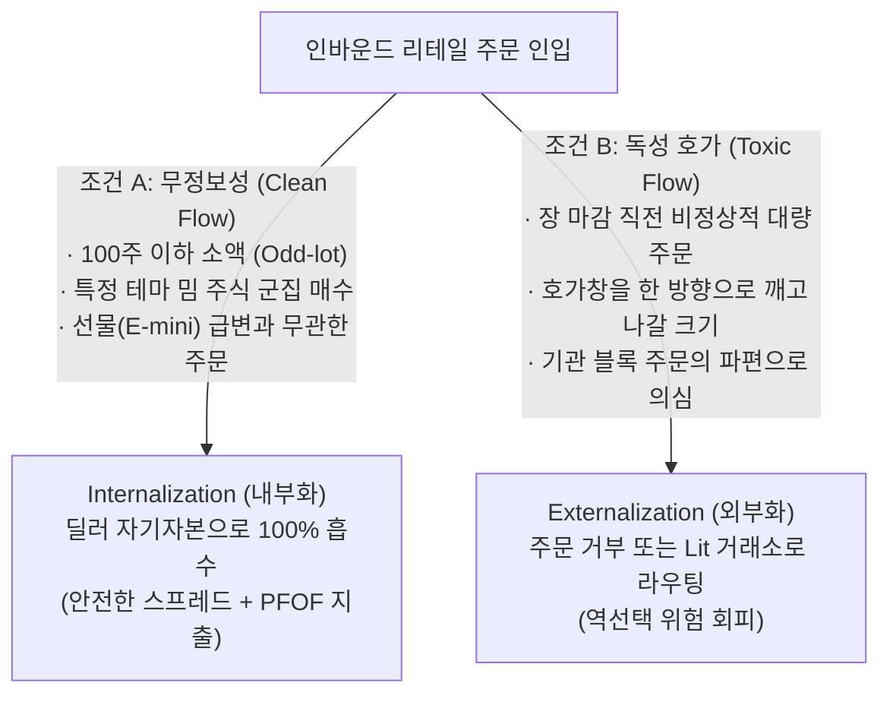

# Chapter 08. Retail Order Flow: 개인 주문과 도매상(Wholesaler)의 내부화

> **원문 위치**: 파트 III. Order Flow > 1. Retail Order Flow (원문 p.40~43)  
> **이 챕터의 핵심 질문**:
> 1. 내가 리테일 증권사(`Robinhood`, `Schwab`)에 낸 주문은 왜 정규거래소가 아닌 도매상(`Wholesaler`)으로 가는가?
> 2. 도매상은 어떻게 `독성 평가(Cream-Skimming)`로 주문의 질을 걸러내고, **가격 개선**과 **PFOF**를 동시에 챙기는가?
> 3. 개인에게는 "무수수료"라는 혜택을 주는 이 구조가 왜 정규 거래소(Lit)의 호가창을 망가뜨린다는 비판을 받는가?

---

## 1. Retail Broker → Wholesaler 라우팅

`Retail Order Flow`는 개인 투자자의 소액 주문 흐름을 말합니다. 개인 투자자는 일반적으로 `Retail Broker`(대표: **Robinhood**, **Charles Schwab** 등)에게 주문을 제출하고, 브로커의 주문관리시스템(**OMS**; Order Management System / **SOR**; Smart Order Routing)은 `Wholesaler Allocation Algorithm`에 따라 어느 도매상에게 보낼지 결정해 라우팅합니다.

> 📝 **원문 노트: 내부 PFOF 라우팅 알고리즘과 `Rule 606` 공시 압박**  
> **1. 내부 PFOF 라우팅 알고리즘 (`Wholesaler Allocation Algorithm`)**  
> - 브로커는 여러 도매상(`Citadel Securities`, `Virtu`, `Two Sigma`, `Jane Street` 등)과 PFOF 계약을 맺어 둡니다.  
> - 시스템은 각 도매상이 과거에 제공한 **가격 개선율(`Price Improvement Rate`, Rule 605 데이터)**과 주당 지급 리베이트(**PFOF 단가**)를 가중 평균해 주문 분배 비율(`Allocation Weight`)을 동적으로 조정합니다.  
>
> **2. `Regulation NMS Rule 606`의 공시 압박**  
> - 브로커는 분기마다 주문 라우팅 보고서(`Rule 606 Report`)를 통해 어느 도매상에 몇 %의 주문을 보냈고 얼마의 PFOF를 수취했는지 의무 공시해야 합니다.  
> - 따라서 특정 도매상이 돈을 많이 준다고 주문을 100% 몰아주면 **최선집행의무(`Best Execution`) 위반 소송**에 휘말리므로, 통상 상위 3~4개 도매상에 `30%, 25%, 20%` 식으로 분산 라우팅합니다.

---

## 2. Wholesaler: Cream-Skimming (크림 걷어내기)

Retail Broker로부터 도매상(Wholesaler; 대표 `Citadel Securities`, `Virtu Financial` 등)에게 주문이 인입되면, 도매상의 Market Making 엔진은 **수 마이크로초 내에** 해당 주문을 **직접 먹을지(`Internalization`)**, **밖으로 뱉을지(`Externalization`)** 결정합니다.

> 💡 **원문 팁: Wholesaler의 수익 모델**  
> Wholesaler의 수익 모델은 **스프레드 이익을 안전하게 취하는 것**입니다. 이를 위해 스프레드 이익을 안전하게 취하기 좋은 리테일 주문을 최대한 공급받아야 하므로 Retail Broker들에게 PFOF를 제공합니다. 리테일 주문은 일반적으로 최신 시장 정보를 반영하는 호가가 아니기 때문에(`Uninformed Flow`), 시장 가격이 급변하는 상황이 아니라면 안전하게 스프레드 이익을 취할 수 있습니다. 따라서 독성 검사(`Toxicity Scoring`) 시 *"안전하게 스프레드 이익을 취할 수 있는 호가인가"*를 평가합니다.

> 📝 **원문 노트: 주문의 독성 평가 (`Toxicity Scoring`) 기준**  
> 1. **주문 크기 (`Order Size`)**: `50주`, `100주` 등 소액 주문은 무조건 통과합니다. 그러나 **`5,000주 이상`의 대형 주문**이 리테일 계좌에서 들어오면 시스템은 경계 모드로 전환합니다.  
> 2. **선물/타 거래소 시세와의 모멘텀 비교**: 마켓메이커는 **시카고 CME의 `E-mini` 선물 시세**와 **각 거래소 독자 직결 시세(`Direct ITCH Feed`)**를 실시간 감시합니다.  
>    - 나스닥 선물이 급락하기 시작한 순간에 유입된 현물 매수 주문은 *'정보가 늦은 리테일 주문'*이므로 도매상이 비싸게 팔아치울 수 있는 좋은 먹잇감(`Clean Flow`)입니다.  
>    - 반대로 선물이 급등하는 타이밍에 절묘하게 매수 주문이 쏟아진다면 정보를 가진 내부자나 알고리즘일 가능성이 높으므로 자체 인벤토리로 받지 않고 외부(`Lit`)로 패스합니다.

---

## 3. Clean Flow (`Internalization`)와 체결 후 처리 흐름

Wholesaler가 독성 평가 결과 안전한 주문으로 판단하면 **자기자본으로 체결의 상대방이 되어 1:1로 체결**시키고 안전한 스프레드 이익을 취하며 PFOF를 지출합니다.

> 📝 **원문 노트: 가격 개선(`Price Improvement`) 제공 알고리즘 — 스프레드 셰어링**  
> 도매상이 자체 체결을 정당화하는 유일한 방패는 **`SEC Rule 611`(NBBO 수호) 준수 및 서브페니(`Sub-Penny`) 가격 개선**입니다.  
>
> - **예시 (`NBBO = Bid $50.00 x Ask $50.04`, 스프레드 4센트)**:  
>   1. 도매상은 개인 매수자에게 `$50.04`(NBO) 대신 **`$50.025`**에 체결해 줍니다. *(고객은 주당 `1.5센트` 절약)*  
>   2. 도매상은 이론적 중간가(`$50.02`) 대비 **`$0.005` 더 비싸게** 매도했으므로 그만큼의 엣지(마진)를 챙깁니다.  
>   3. 챙긴 마진 `$0.0050` 중 **`$0.0015`**를 리테일 브로커에게 **PFOF**로 떼어주고, 도매상은 **순마진 `$0.0035`**를 확정 짓습니다.

### Wholesaler 장부 체결 후 3단계 시스템 처리

1. **`FINRA TRF` (`Trade Reporting Facility`) 전송**:
   - 도매상 매칭 엔진은 체결 완료 패킷을 즉시 `FINRA/Nasdaq TRF` 또는 `FINRA/NYSE TRF`로 전송합니다.
   - 법정 제한 시간은 `10초`이지만, 실제로는 **`1~2밀리초` 이내**에 전자 보고됩니다.
   - TRF는 체결 플래그에 **Venue Code `'D'` (장외 보고)**와 함께 `'PRP (Prior Reference Price)'` 또는 `'Price Improvement'` 특수 체결 코드를 태워 SIP로 쏩니다.
2. **`SIP` 배포**:
   - `Consolidated Tape` (`CTA Tape A/B`, `UTP Tape C`)에 체결 틱이 찍히며, 전 세계 시세 화면(Bloomberg, HTS 등)에 **`$50.025 (거래소: D)`** 형태로 반영됩니다.
3. **`NSCC` 맞체결 (`Novation`)**:
   - TRF는 보고받은 매수자(리테일 브로커) - 매도자(도매상 딜러) 간 체결 데이터를 야간 배치 또는 실시간으로 `NSCC`로 넘겨 **`CNS`(다자간 차감)** 큐에 편입시킵니다.

---

## 4. Toxic Flow (`Externalization`)와 Lit 호가장의 딜레마

Wholesaler가 독성 평가 결과 안전하지 않은 주문으로 판단하면 즉시 주문을 거부하거나 NBBO를 게시 중인 **Lit 거래소**로 라우팅합니다.

> 💡 **원문 팁: `Lit 거래소 호가장의 독성 오염`**  
> 이 리테일 플로우 내부화 구조가 정규 거래소(`Lit`)에 미치는 파급 효과는 치명적입니다.
> - 시장에서 가장 안전하고 돈이 되는 무정보성 주문('크림')은 도매상이 장외에서 전부 걷어갑니다. (**전체 호가의 약 80~90%**)
> - NYSE, Nasdaq 등 공개 오더북에 남는 것은 방향성(`Trend`)을 가진 헤지펀드·연기금의 대량 분할 주문, 초단타 차익거래 주문(**약 10~20%의 정보성 주문**)뿐입니다.
> - 거래소에 지정가 호가를 대는 마켓메이커들은 정보성 주문의 반대 체결자가 되면서 언제 큰 물량에 밀려 손실을 볼지 모르기 때문에(**`Adverse Selection`**), **호가 스프레드를 넓히고 호가 깊이(`Depth`)를 얇게 깔 수밖에 없습니다.**
> - 결국 **"개인은 무수수료와 가격 개선을 누리지만, 시장의 공공재인 공개 거래소의 가격 발견 기능과 유동성은 지속적으로 약화되는" 구조적 딜레마**가 형성됩니다.

---

## 추가 설명자료: 쉽게 이해하기

### 핵심 용어 사전

| 용어 | 쉬운 풀이 |
| :--- | :--- |
| **Cream-Skimming** | 우유 위에 뜬 맛있는 크림만 떠먹고 맹물은 남긴다는 뜻. 도매상이 먹기 좋은 안전한 개인 주문(크림)만 내부에서 챙기고 위험한 주문은 거래소로 떠넘기는 전략. |
| **Internalization (내부화)** | 고객 주문을 외부 거래소로 내보내지 않고 브로커나 도매상이 자기 장부(재고)와 직접 1:1 맞체결시키는 것. |
| **Externalization (외부화)** | 내 장부로 받기 위험한(독성) 주문을 외부 공개 거래소(NYSE, Nasdaq 등)로 내보내는 것. |
| **Odd-lot (단주)** | 미국 주식의 전통적 표준 거래 단위(`Round Lot` = 100주) 미만(1~99주)의 소액 주문. |
| **Venue Code `'D'`** | 시세창이나 체결 테이프(SIP)에서 **"이 거래는 정규거래소가 아니라 FINRA ADF/TRF 장외 보고 시설(도매상 내부화 또는 다크풀)에서 체결됨"**을 뜻하는 코드. |

### 쉬운 비유 & 숫자 복기: "1,000달러짜리 중고폰 매입가와 4센트 스프레드"

도매상(`Citadel Securities`)이 왜 개인에게 오히려 시장보다 싸게 팔아주면서도 돈을 버는지 숫자로 정리하면 100% 이해됩니다.

- 현재 공개 거래소(`NBBO`) 기준 가격: 매수 1호가 **`$50.00`** / 매도 1호가 **`$50.04`** (이론적 진짜 가치인 중간가 = **`$50.02`**)
- 만약 개인 투자자 철수가 정규 거래소에서 시장가로 사면 **`$50.04`**를 내야 합니다.
- 이때 도매상은 중간가(`$50.02`)보다 약간 비싼 **`$50.025`**에 철수에게 주식을 팔아줍니다!
  - **철수(개인) 입장**: `$50.04` 대신 `$50.025`에 샀으니 **주당 `$0.015` (1.5센트) 이익!** + 수수료도 무료!
  - **리테일 브로커(로빈후드) 입장**: 도매상으로부터 주문 1건당 **`$0.0015`**를 PFOF 현금으로 받아 **이익!**
  - **도매상 입장**: 중간가(`$50.020`) 기준으로 보면 `$0.0050` 비싸게 판 것이고, 곧바로 다른 개인이 `$50.015`에 팔러 올 때 사서 되메우면 됩니다. `$0.0050 - $0.0015(PFOF) = 주당 $0.0035` 순이익!

**단 하나의 전제 조건**: 방금 산 사람(철수)이 **미래 주가 정보를 모르는 일반 개인(`Clean Flow`)**이어야만 합니다. 만약 철수 탈을 쓴 헤지펀드(`Toxic Flow`)여서 산 직후 주가가 `$52.00`로 폭등한다면 도매상은 대참사(역선택 손실)를 당하므로, 나노초 만에 독성 필터를 돌리는 것입니다!
