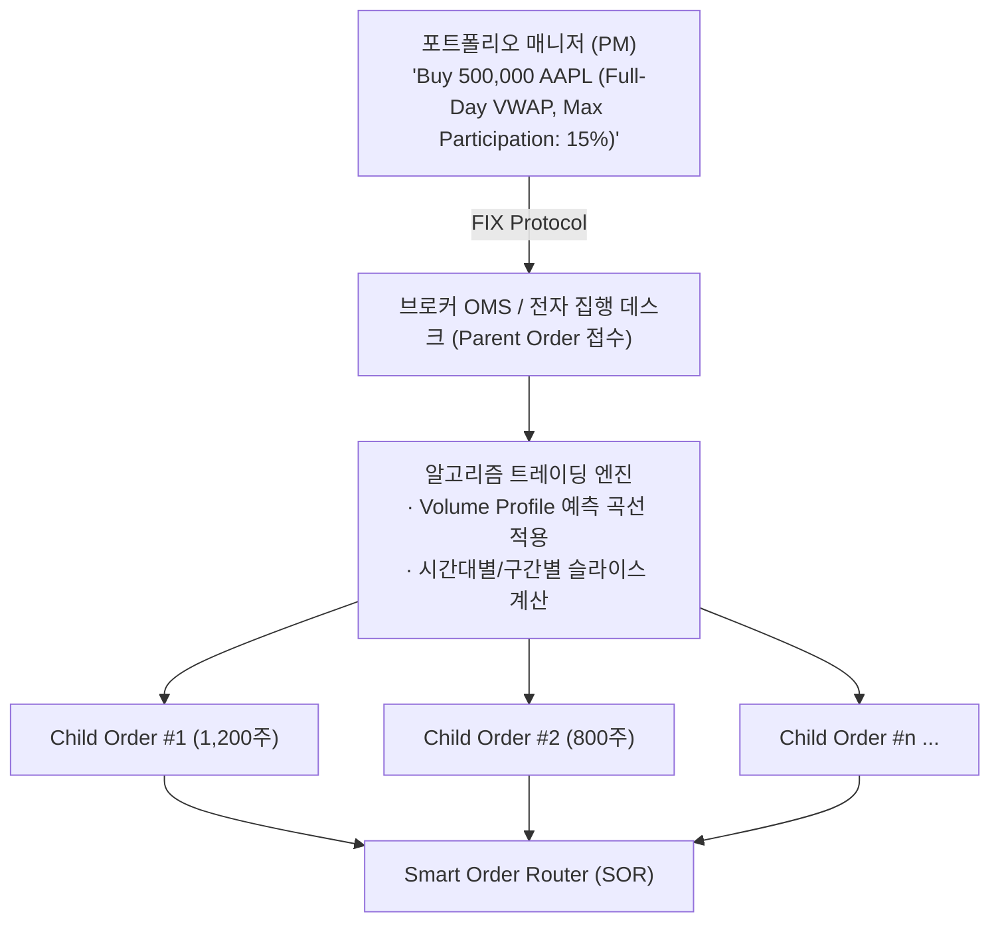
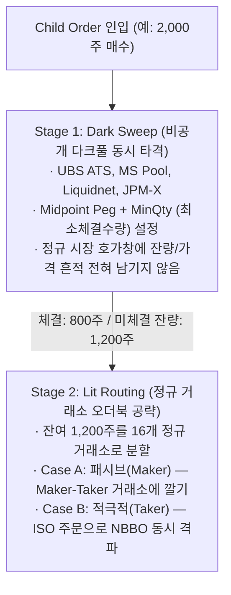
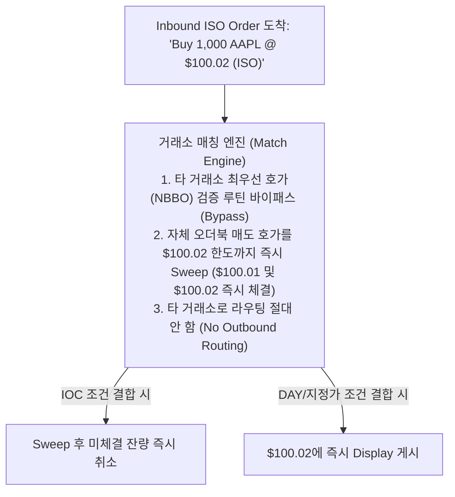

# Chapter 09. Institution Algorithmic Order Flow: 모·자 주문 분할과 ISO

> **원문 위치**: 파트 III. Order Flow > 2. Institution Algorithmic Order Flow (원문 p.44~49)  
> **이 챕터의 핵심 질문**:
> 1. 기관 투자자 주문에서 **시장가 vs 지정가 슬리피지**(기회비용 & 역선택 위험)는 어떻게 정의되는가?
> 2. 50만 주짜리 대량 모 주문(`Parent Order`)을 쪼개는 4대 알고리즘(`VWAP`, `TWAP`, `POV`, `IS`)의 장단점은 무엇인가?
> 3. 자 주문(`Child Order`)의 **Dark-First Waterfall 라우팅**과 **ISO(`Intermarket Sweep Order`)**의 작동·법적 책임 구조는 어떠한가?

---

## 1. 기관 주문의 목표와 슬리피지(`Slippage`) 최소화

대형 기관투자자(연기금, 뮤추얼 펀드, 헤지펀드 등)의 `Institutional Algorithmic Order Flow`는 리테일 주문과 정반대의 제약 조건을 갖습니다. 주문 규모가 시장 일일 거래량(`ADV`) 대비 상당한 비중을 차지하므로, 최대 목표는 **시장 충격(`Market Impact`)과 시그널 누출(`Information Leakage`)을 최소화**하면서 벤치마크(`VWAP`, `TWAP`, `Arrival Price`) 대비 **슬리피지(`Slippage`)**를 줄이는 것입니다.

> 💡 **원문 팁: 알고리즘 트레이딩에서의 슬리피지 최소화 (직접 vs 간접)**  
> 기본 개념은 `Reg NMS Rule 605`의 `Expected Price vs Executed Price` 차이와 같으나, 기관 알고리즘 트레이딩 및 거래비용 분석(**TCA**; Transaction Cost Analysis)에서는 **암묵적 거래비용**을 핵심 측정 요소로 삼습니다.
>
> **1. 시장가 주문 (`Market Order`) — 직접적·전통적 가격 슬리피지 (`Price Slippage`)**  
> - 주문 전송 당시 화면 최우선 호가보다 실제 체결 가격이 불리해지는 현상입니다.
> - 주문 수량이 최우선 호가 잔량을 넘어 여러 호가를 파고들며 체결되거나(`Market Impact`), 통신 레이턴시 동안 호가가 먼저 소진될 때 발생합니다.
>
> **2. 지정가 주문 (`Limit Order`) — 2가지 간접적 슬리피지**  
> 지정가 주문은 불리한 가격에 체결될 일은 원천적으로 없지만, TCA에서는 아래 두 가지를 핵심 거래비용으로 집계합니다.
> - **① 미체결로 인한 기회비용 (`Implementation Shortfall / Opportunity Cost`)**: 시장 가격이 내 지정가에 도달하지 않고 반대 방향으로 계속 달아나 미체결·부분체결(`Partial Fill`)되면, *"포지션을 잡지 못해 놓친 손실"*을 부정적 슬리피지(`Negative Slippage`)로 평가합니다.
> - **② 역선택 위험 (`Adverse Selection Risk`)**: 내 지정가 주문이 체결되었다는 것은 더 빠르고 정보력이 우수한 참가자(`Aggressive Taker`)가 내 물량을 먹고 지나갔다는 뜻입니다. 체결 직후 시장 가격이 나에게 불리한 방향으로 급격히 움직여 평가손이 발생하는 현상을 체결 후 슬리피지로 간주합니다.

---

## 2. 모 주문(`Parent Order`)의 Slicing

포트폴리오 매니저(`PM`; Portfolio Manager)가 대량의 모 주문을 `Broker OMS`에 입력하면 `Algorithm Trading` 엔진은 시장 충격이 발생하지 않도록 4대 알고리즘을 활용해 **수백~수천 개의 자 주문(`Child Order`)**으로 쪼갭니다.

| 대표 알고리즘 | 목적 함수 및 메커니즘 | 취약점 및 HFT의 역이용 방식 |
| :--- | :--- | :--- |
| **VWAP** *(거래량가중평균)* | 과거 역사적 거래량 곡선(**U자형 곡선**: 개장 직후/장마감 직전 집중)을 바탕으로 당일 시장 평균 체결가 추종 | 볼륨 패턴이 정형화되어 있어 HFT 퀀트 모델이 기관의 참여율을 역추정하기 쉬움 |
| **TWAP** *(시간가중평균)* | 장 시작부터 마감까지 시간을 균등 분할해 일정 시간 간격마다 균등 수량 집행 | 주기성(`Periodicity`)이 노출되면 슬라이스 타이밍 직전에 **프런트러닝(선행매매)** 타깃이 됨 *(Randomized 슬라이싱 필수)* |
| **POV** *(Percentage of Volume)* | 실제 실시간 시장 거래량의 일정 비율(예: `10~20%`)만 기계적으로 매칭 참여 | 거래량이 마르면 집행 속도가 지연되어 마감 시간(`EOD`)까지 미체결 잔량이 대거 남는 위험 |
| **Implementation Shortfall (IS)** | 주문 접수 시점 가격(`Arrival Price`) 대비 최종 체결가의 슬리피지 최소화 (모멘텀과 스프레드 비용 간 동적 트레이드오프 계산) | 시장이 불리하게 움직일 때(급등 시) 적극적 시장가(`Aggressive Taker`) 주문으로 전환되어 비용 폭증 가능 |

---

## 3. 자 주문(`Child Order`)의 다계층 집행 (`Waterfall Routing`)

자 주문이 생성되면 **SOR**은 신호 누출을 막기 위해 정규 거래소(`Lit`)에 바로 호가를 던지지 않고 **비공개 풀부터 순차적으로 탐색(`Waterfall Routing`)**합니다.

### 3.1 다크풀 우선 탐색 (`Dark-First Routing`)
- SOR은 먼저 복수의 ATS/다크풀로 **NBBO 중간가 연동(`Midpoint Peg`)** 조건과 **최소 체결 수량(`MinQty`: 예 500주)**을 붙여 비공개 주문을 쏩니다.
- **스프레드 비용 절감**: 성사될 경우 스프레드의 절반(`$0.005` 단위)을 절약하며 외부에 흔적을 남기지 않습니다.
- **Information Leakage 리스크**: 만약 소형 다크풀에 찔러본 주문이 체결되지 않거나 HFT가 심어둔 **'탐침 호가(`Ping Order`: 100주)'**에 걸리면, HFT 알고리즘이 *"대형 매수자가 숨어 있다"*는 신호를 감지하고 Lit 거래소의 매도 호가를 선제적으로 취소·상향 조정합니다.

### 3.2 Lit 거래소 분할 집행 (`Lit Slicing & ISO Routing`)
다크풀에서 소화되지 못한 잔량은 정규 거래소로 넘어가며 두 가지 방식으로 집행됩니다.
1. **패시브 대기 (`Passive Display`)**:
   - 유동성 리베이트를 주는 `Maker-Taker` 거래소(`Nasdaq, NYSE, Cboe BZX`)에 지정가로 분산 배치합니다.
   - HFT에게 대기 총량이 읽히지 않도록 **Reserve Order (`Iceberg`)** *(겉으로는 100주만 보이고 내부에 1,000주가 숨어 있는 호가)*를 적극 활용합니다.
2. **어그레시브 스윕 (`Aggressive Sweep with ISO`)**:
   - 가격이 위로 튈 조짐이 보여 즉시 긁어야 할 경우, `Rule 611` 예외인 **ISO(`Intermarket Sweep Order`)** 플래그를 달아 각 거래소 최우선 매도호가(`Ask`) 잔량만큼 정확히 쪼개 동시에 병렬 전송합니다.
   - 거래소 간 레이턴시 차이로 한 거래소에서 먼저 체결돼 타 거래소 호가가 도망가는 현상(`Race Condition`)을 막기 위해, SOR은 각 거래소 데이터센터까지의 물리적 지연시간을 계산해 발주 시점을 마이크로초 단위로 조절하는 **지연 동기화(`Latency Floor / Pacing`)** 기법을 적용합니다.

---

## 4. 심층 참고: `ISO (Intermarket Sweep Order)` 완전 해부

복수거래소 체제에서 `SEC Reg NMS Rule 611`(Trade-Through 방지 규칙)의 예외를 인정받기 위해 설계된 특수 주문 플래그입니다.

### 4.1 탄생 배경: `Rule 611`과 일반 주문의 체결 병목
- 가정: `Nasdaq` 매도 호가가 **`$100.01 (200주)`**, **`$100.02 (1,000주)`**이고, `NYSE` 매도 호가가 **`$100.01 (100주)`**인 상태.
- 구매자가 Nasdaq에 일반 주문으로 `$100.02`에 `1,000주` 매수를 넣으면, Nasdaq 엔진은 `$100.01` 잔량 `200주`만 먼저 체결시키고 나머지 `800주`는 `$100.02`로 바로 체결할 수 없습니다. **타 거래소(NYSE)에 더 좋은 가격(`$100.01`)이 100주 살아있기 때문**입니다.
- 따라서 Nasdaq 엔진은 체결을 멈추고 NYSE로 라우팅하거나 호가를 재조정(`Re-pricing`)해 대기시키며, 이 과정에서 **체결 지연과 슬리피지**가 발생합니다.

### 4.2 법적 정의 및 면책 요건 (`SEC Rule 600(b)(38)` & `Rule 611(b)(6)`)
ISO는 발주자(브로커 SOR 또는 HFT)가 다음과 같은 **법적 선언**을 하는 주문입니다.
> *"내가 목표로 하는 가격보다 더 유리한 타 거래소의 모든 Protected Quotation(NBBO) 잔량을 소진시키기 위해, 다른 거래소들로도 필요한 수량만큼의 주문을 동시에 제출했다."*  
발주자가 이 법적 책임을 지는 대가로, 주문을 수신한 거래소 매칭 엔진은 타 거래소 호가를 확인할 법적 의무를 완전히 면제받습니다.

### 4.3 매칭 엔진 내부의 ISO 처리 시퀀스
ISO 플래그(예: `FIX Tag 40=d` 또는 바이너리 `OUCH` 프로토콜 특수 플래그)가 붙은 패킷이 게이트웨이에 도달하면 다음과 같이 작동합니다.

- **지연시간 극소화 (`Latency Advantage`)**: 타 거래소 시세 테이블 대조(`if-condition` 분기)를 건너뛰어 엔진 내부 레이턴시가 가장 짧습니다.
- **오더북 깊숙이 격파**: 발주자가 지정한 리밋 가격까지 자체 오더북 매물을 그 자리에서 일괄 체결(`Sweep`)합니다.

### 4.4 SOR의 실제 ISO 집행 예시: 동시 격파 (`Simultaneous Sweep`)
- **시장 상황**: `Nasdaq` `$100.01 (500주) / $100.02 (1,000주)`, `NYSE` `$100.01 (300주) / $100.02 (2,000주)`, `Cboe BZX` `$100.01 (200주)`
- **목표**: `$100.02`까지 총 **`3,000주`**를 즉시 매수하고자 할 때:
  1. SOR은 `$100.01`(NBBO)에 걸린 타 거래소 잔량(`NYSE 300주`, `Cboe 200주`)을 정확히 소진시킬 매수 주문을 해당 거래소로 동시 발송합니다.
  2. 동시에 Nasdaq(`$100.01 500주 + $100.02 1,000주`)과 NYSE(`$100.02` 잔량분)로 **`$100.02`까지 쓸어 담는 ISO 주문**을 날립니다.
  3. 세 거래소는 타 거래소 눈치를 보지 않고 접수 즉시 자사 오더북을 체결시킵니다.

### 4.5 주요 ISO 파생 유형
1. **`Sweep and Clear (ISO IOC)`**: 가장 흔한 형태. 지정가 한도까지 싹 쓸어 체결한 뒤 남는 잔량은 오더북에 남기지 않고 즉시 취소(`Immediate or Cancel`).
2. **`Display ISO (ISO Day / Post-Only ISO)`**: HFT·마켓메이커 애용 전략. 타 거래소 동일 가격 호가를 소진시키는 ISO를 쏘는 동시에, 대상 거래소에는 `$100.02` 지정가 호가를 오더북에 즉시 게시(`Display`)하도록 명령. 일반 호가라면 `Rule 610` 잠금/교차 호가 규제로 리프라이싱되겠지만, ISO 플래그가 붙으면 규제를 우회해 해당 가격 최우선 큐(`Queue Priority`)로 호가를 노출해 줍니다.

### 4.6 제도적 리스크 및 감시 포인트 (`FINRA / SEC`)
- **Trade-Through 책임 전가**: 일반 주문에서 Trade-Through가 발생하면 거래소 엔진의 책임이지만, ISO를 사용했을 때 타 거래소 최우선 호가를 제대로 소진시키지 못해 발생한 책임은 **100% 발주한 증권사(Broker-Dealer)에 귀속**됩니다.
- **FINRA 감시 시스템 사후 검증 (`CAT`)**: FINRA는 **CAT** 데이터를 통해 ISO 발주 시점의 **마이크로초 타임스탬프**를 대조합니다. Nasdaq에서 `$100.02`를 치는 ISO를 보낸 시각에 NYSE `$100.01`을 향해 쏜 연계 주문(`Routing child order`)이 실제로 동시 전송되었는지 검증해 누락 시 거액의 과징금을 부과합니다.

---

## 추가 설명자료: 쉽게 이해하기

### 핵심 용어 사전

| 용어 | 쉬운 풀이 |
| :--- | :--- |
| **Parent Order / Child Order** | 펀드 매니저가 낸 거대 원본 주문(`모 주문`, 예: 50만 주)을 알고리즘이 시장 충격을 피하려 수천 개로 잘게 자른 개별 조각(`자 주문`, 예: 200주). |
| **U자형 거래량 곡선** | 주식시장은 장 시작 직후(09:30~10:30)와 마감 직전(15:00~16:00)에 거래량이 폭증하고 점심시간엔 한산해 U자 모양을 띠는 현상. VWAP이 이를 따라갑니다. |
| **Ping Order (탐침 호가)** | HFT가 다크풀에 100주짜리 미끼를 찔러놓고, 그게 체결되는지 안 되는지로 *"지금 뒤에 큰 기관이 숨어 있구나!"*를 탐지하는 정찰용 소량 주문. |
| **Iceberg / Reserve Order** | 수면 위 빙산의 일각처럼 호가창엔 100주만 보여주지만 실제 내부엔 1,000주 이상을 숨겨두고 100주가 먹힐 때마다 자동 리필하는 주문. |
| **Race Condition & Pacing** | NY와 NJ 데이터센터 간 광케이블 거리 차이 때문에 A거래소에 주문이 0.0001초 먼저 도착해 타 거래소 HFT가 눈치채고 호가를 빼버리는 현상(`Race Condition`)을 막기 위해, 가까운 거래소엔 일부러 미세하게 늦춰 쏘는 기술(`Pacing`). |

### 쉬운 비유: "코끼리를 숨겨서 한 번에 방으로 옮기기"
- **Dark-First Waterfall**: 큰 가구(2,000주)를 들이기 전에 먼저 커튼 뒤 비밀 창고(다크풀)들을 싹 훑어서 흔적 없이 800주를 조달합니다.
- **ISO 동시 격파**: 남은 1,200주를 공개 시장에서 급히 사야 할 때, 매장 3곳(NYSE, Nasdaq, Cboe)의 직원에게 한 곳씩 차례로 물어보면 앞 매장에서 사자마자 뒷 매장들이 가격을 올려버립니다. 그래서 **3곳 매장에 동시에 사람을 보내("Pacing")** 가장 싼 매대부터 한 번에 쓸어 담는 것이 **ISO**입니다. 단, 한 곳이라도 빼먹으면 법 위반(CAT에 밀리초 단위로 다 찍혀서 걸림!)이 됩니다.
