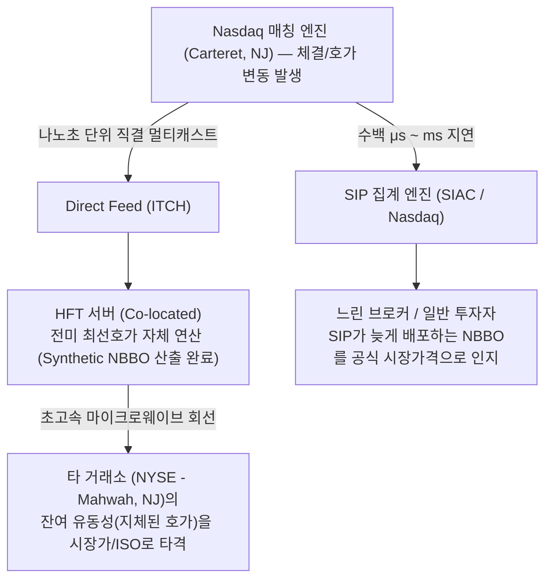
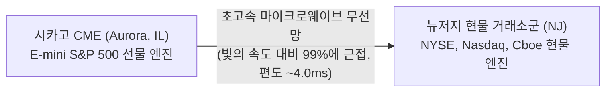

# Chapter 10. Passive & Benchmark Flow와 Proprietary & HFT Flow

> **원문 위치**: 파트 III. Order Flow > 3. Passive & Benchmark Flow & 4. Proprietary & HFT Flow (원문 p.50~55)  
> **이 챕터의 핵심 질문**:
> 1. 패시브 인덱스 펀드와 ETF 자금은 왜 장중 거래를 피하고 **16:00:00 종가 단일가**에 몰리는가? 이로 인해 생기는 차익거래와 **장중 공동화**는 무엇인가?
> 2. HFT는 어떻게 **공공 시세(`SIP`)와 직결 시세(`Direct Feed`)의 속도 차이** 및 **시카고 선물↔뉴저지 현물 마이크로웨이브망**을 이용해 무위험 수익을 얻는가?
> 3. HFT의 핵심 호가 제어 기법(`Post-Only`, `Pegged`, `98% 대량 취소`)과 거래소 인프라 혁신(`코로케이션`, `바이너리 프로토콜`, `IEX 스피드 범프`)은 어떻게 맞물려 돌아가는가?

---

## 1. Passive & Benchmark Flow

패시브 인덱스 펀드와 ETF의 기계적 리밸런싱 수요가 집중되는 구간으로, 하루 중 가장 유동성이 폭발하는 흐름입니다.

### 1.1 패시브 자금의 장마감 집중 (`Tracking Error`의 구조적 회피)
S&P 500, Nasdaq 100, Russell 2000 등을 추종하는 패시브 인덱스 펀드(`Vanguard`, `BlackRock` 등)와 ETF 지정참가회사(**AP**; Authorized Participant)의 성과 측정 기준은 '알파'가 아니라 **벤치마크 지수 대비 추적오차(`Tracking Error = 0`)**입니다.

- **지수 산출의 기준점**: 지수 산출 기관(`S&P Dow Jones`, `Nasdaq` 등)은 당일 지수의 공식 종가(`Official Close`)를 산출할 때 장중 체결가가 아닌 **각 종목 주상장 거래소(`Primary Listing Exchange`)의 단일가 경매 체결 가격(`Official Closing Price`)을 100% 반영**합니다.
- **MOC 집중**: 패시브 펀드가 장중 연속매매에서 슬리피지를 감수하고 주식을 사 모으면 지수 종가와의 괴리(`Tracking Error`)가 필연적으로 발생합니다. 따라서 *"공식 종가와 단 1센트의 오차도 없이 동일한 가격에 체결"*되도록 보장하는 **MOC(`Market-on-Close`)** 및 **LOC(`Limit-on-Close`)** 주문을 주상장 거래소에 대량 인젝션합니다.
- **집중도**: 이로 인해 미국 전체 주식 거래량의 **약 `6.5% ~ 8.5%`**(월말·분기말 리밸런싱 및 선물·옵션 동시 만기일인 **`Quadruple Witching Day`에는 `20% 이상`**)가 **`16:00:00` 정각 단 몇 밀리초 사이에 단일가로 체결**됩니다.

### 1.2 시장 미시구조적 영향 및 차익거래 (`Arbitrage`)
1. **Closing Imbalance Arbitrage (불균형 차익거래)**:
   - 헤지펀드와 HFT 퀀트 데스크는 `15:50` 이후 실시간 배포되는 불균형 공시 데이터(**NOII**; *Net Order Imbalance Indicator*)를 모니터링합니다.
   - 대규모 `Buy Imbalance`(매수 초과)가 공시되면 종가가 장중 가격보다 높게 튈 가능성이 커집니다.
   - 알고리즘은 즉시 장중 연속매매 시장(`Lit`)에서 주식을 싸게 매수하고, 동시에 경매 장부에는 매도 `LOC` 또는 `IO(Imbalance Only)` 호가를 던져 종가에 비싸게 팔아넘기는 단기 무위험/저위험 차익 스프레드를 수취합니다.
2. **시장 유동성의 흡수 (`Crowding-out` / 장중 공동화)**:
   - 트레이더들이 장중 체결에 따른 슬리피지와 정보 유출을 꺼려 장마감 경매로 주문을 미루면서, **`14:00 ~ 15:30` 구간**의 장중 연속매매 유동성이 마르고 호가창이 얇아지는 **장중 공동화(`Mid-day Liquidity Slump`)** 현상이 구조화되었습니다.

---

## 2. Proprietary & HFT Flow

HFT와 프랍 트레이딩 펌(`Jump Trading`, `Tower Research`, `Hudson River Trading`, `Citadel Securities` 등)은 방향성 투자가 아닌 **마이크로초(`μs`) ~ 나노초(`ns`) 단위의 속도 우위(`Latency Advantage`)**를 활용해 무위험에 가까운 스프레드 마진과 차익거래 기회를 포착합니다.

### 2.1 `SIP` vs. `Direct Feed` 간 지연시간 차익거래 (`Latency Arbitrage`)

미국 시장의 복수 거래소 구조에서 필연적으로 발생하는 공공 시세(`SIP`)와 거래소 직결 시세(`Proprietary Direct Feed`) 간의 속도 격차(`Latency Gap`)를 공략하는 전략입니다.

- **메커니즘: `Synthetic NBBO` 선점**
  - **SIP 지연**: SIP는 16개 거래소 데이터를 물리적으로 취합·계산해 전송하므로 **수십 마이크로초에서 수 밀리초**의 지연이 발생합니다.
  - **HFT의 자체 NBBO**: HFT는 각 거래소 데이터센터에 서버를 두고(`Co-location`), 거래소가 직접 쏘는 `Level 3` 바이너리 멀티캐스트 피드(`Nasdaq ITCH`, `NYSE Pillar Feed`)를 받아 자체 **FPGA** *(프로그래밍 가능 반도체)* 보드에서 가상의 최선호가(`Synthetic NBBO`)를 나노초 단위로 먼저 계산합니다.
  - **타격 (`Sniping Stale Quotes`)**: 예컨대 Nasdaq에서 대형 매수로 주가가 `$100`에서 `$101`로 오르는 순간, 뉴저지 Mahwah에 있는 NYSE 오더북에는 아직 SIP 시차가 반영되지 않아 `$100.00`에 매도 호가를 대놓은 느린 참여자의 주문이 남아 있을 수 있습니다. HFT는 마이크로웨이브 무선통신을 통해 NYSE로 즉시 ISO/시장가 주문을 쏴 그 **지체된 호가(`Stale Quote`)**를 `$100.00`에 낚아챈 뒤 Nasdaq에 `$101.00`에 되팔아 무위험 차익을 확정합니다.

### 2.2 시장조성(`Market Making`)과 특수 호가 제어

HFT 마켓메이커는 장내 오더북 양방향에 끊임없이 유동성을 공급해 비드-애스크 스프레드와 `Maker Rebate`를 수취하며, 이때 3가지 시스템 제어 기법을 필수적으로 사용합니다.

1. **`Post-Only` 주문 (`Maker-Taker 최적화`)**:
   - 마켓메이커는 수수료를 내는 `Taker`가 되는 순간 마진이 무너지므로 무조건 리베이트를 받는 `Maker`로만 체결되어야 합니다.
   - `Post-Only` 플래그를 붙이면 상대방 오더북 기존 잔량과 즉시 맞부딪쳐 체결될 위험이 있는 가격일 때, 체결을 실행하지 않고 **주문을 즉시 취소(`Cancel`)하거나 1틱 뒤로 자동 리프라이싱(`Re-price`)**해 오더북 잔량으로만 안착시킵니다.
2. **페깅 호가 (`Pegged Orders`)**:
   - 고정 가격 대신 *"NBBO의 최우선 호가 또는 중간가를 1마이크로초 단위로 추종하라"*는 특수 조건을 부여합니다.
   - **`Primary Peg`**: 시장 최우선 매수호가와 동일 가격을 유지하도록 거래소 엔진 내부에서 자동 갱신.
   - **`Midpoint Peg`**: 호가창 중간값을 계속 추종해 숨겨진 유동성(`Hidden`)으로 대기.
3. **나노초 단위의 대량 취소 (`Cancel-to-Fill Ratio`)**:
   - 핵심 방어 기법은 *"불리한 체결 위험(`Adverse Selection`)을 감지하는 순간 상대 주문이 도달하기 전에 내 지정가 호가를 먼저 취소하는 것"*입니다.
   - 대형 기관 분할 주문 진입이나 선물 급변을 감지하면 오더북의 수만 건 지정가 호가를 **즉시 취소(`Mass Cancel`)**합니다.
   - 이로 인해 HFT 마켓메이커의 전체 주문 대비 체결 비율(`Fill Rate`)은 통상 **`1~2% 미만`**에 불과하며, 주문의 **`98% 이상`이 취소(`Cancel`) 패킷**으로 채워집니다.

### 2.3 선물-현물(`Cash-Futures`) 간 베이시스 차익거래

주식 현물 거래소(**뉴저지 일대**: `Secaucus`, `Carteret`, `Mahwah`)와 지수 선물 거래소(**시카고 CME 오로라 데이터센터**: `Aurora, IL`) 간의 물리적 거리(**약 1,200km**)를 연결하는 전략입니다.

1. **선물 선행성 (`Futures Lead Cash`)**: 거시경제 지표 발표나 뉴스 이벤트 시 유동성이 가장 깊은 CME의 S&P 500 선물(`ES`) 또는 나스닥 100 선물(`NQ`)이 현물 주식보다 **수 밀리초 먼저** 반응합니다.
2. **차익 알고리즘 구동**: 시카고에서 선물이 3틱 급등하면, 그 신호는 광섬유 케이블이 아니라 대기 중을 가로지르는 마이크로웨이브 안테나 타워 망을 통해 **`4.0~4.1밀리초`** 만에 뉴저지 데이터센터로 날아옵니다. 뉴저지 대형 우량주(애플, 마이크로소프트 등) 가격이 아직 선물 상승분을 반영하지 못했으면 HFT 봇은 즉시 현물 주식을 매수하고 선물을 매도해 베이시스 스프레드를 락(`Lock`)합니다.

### 2.4 참고: 거래소에 미친 영향

HFT Flow의 지배력이 커지면서 미국 거래소들은 속도 경쟁을 수용하거나 반대로 방어하기 위한 인프라 혁신을 단행했습니다.

| 인프라 / 제도 | 기술적 구현 내용 및 목적 |
| :--- | :--- |
| **코로케이션 (`Co-location`)** | 거래소 매칭 엔진 바로 옆 랙(`Rack`)에 HFT 서버를 입주시키고, 광케이블 길이를 **인치 단위까지 동일하게 맞춰** 공평한 나노초 환경 제공 |
| **바이너리 프로토콜** | 무거운 텍스트 기반 `FIX` 프로토콜 대신 초경량 바이너리 프로토콜(`Nasdaq OUCH`, `NYSE Pillar Binary`)을 도입해 엔진 파싱 딜레이를 나노초로 압축 |
| **속도 지연 장치 (`Speed Bump`)** | **IEX**(`Investors Exchange`)가 도입한 방식으로, 거래소 인입구에 **38마일 길이의 광케이블 코일(`Coil`)**을 감아 인위적으로 **350마이크로초(`μs`) 지연**을 발생시켜 HFT의 레이턴시 아비트라지를 무력화 |

---

## 추가 설명자료: 쉽게 이해하기

### 핵심 용어 사전

| 용어 | 쉬운 풀이 |
| :--- | :--- |
| **Tracking Error (추적오차)** | 패시브 펀드/ETF의 수익률이 추종 지수(예: S&P 500) 수익률에서 벗어난 차이. 패시브 운용사의 KPI는 이 오차를 `0`에 가깝게 만드는 것입니다. |
| **Quadruple Witching Day** | '네 마녀의 날'. 3·6·9·12월 셋째 주 금요일에 주가지수 선물·옵션, 개별주식 선물·옵션 4가지 만기가 한날에 겹쳐 종가 거래량이 평소의 3~4배(20%+) 폭증하는 날입니다. |
| **FPGA** | 일반 CPU에서 소프트웨어가 도는 시간조차 아까워서, 매매·시세 해석 알고리즘을 아예 **반도체 하드웨어 회로(칩) 자체에 구워 넣은** 초고속 연산 보드. |
| **Stale Quote (지체된 호가)** | 최신 뉴스나 타 거래소 급등으로 가치가 이미 바뀌었는데, 시세 수신이 늦어 미처 취소되지 못하고 옛날 가격으로 남아 있는 방치된 호가. |
| **Basis (베이시스)** | 선물 가격과 현물 가격의 차이 (`선물 가격 - 현물 가격`). |

### 쉬운 비유: 왜 광케이블 대신 마이크로웨이브 공중 무선망을 쓰나?
시카고(CME)에서 뉴저지(NYSE/Nasdaq)까지 직선거리는 약 **1,200km**입니다.
- **광섬유 케이블(유리 속 빛)**: 굴절률 때문에 빛 속도의 약 **67%(~20만 km/s)**로만 달릴 수 있고, 땅속 철도·도로를 따라 구불구불 우회해 편도 **~6.5~8ms** 걸립니다.
- **마이크로웨이브 안테나(공기 중 빛)**: 직선 경로로 공기를 뚫고 빛 속도의 약 **99%(~30만 km/s)**로 달려 편도 **`4.0~4.1ms`** 만에 도착합니다!
- 겨우 `2.5~4ms`(눈 한 번 깜빡이는 시간 300ms의 약 1/100!) 차이지만, 이 차이 덕분에 HFT는 뉴저지 호가창의 느린 주문을 싹 쓸어 담을 수 있습니다. 반대로 IEX는 바로 그 시간차 공격을 막으려고 입구에 **38마일(약 61km)짜리 코일을 빙빙 감아 `0.35ms(350μs)` 강제 지연**을 걸어 놓았습니다!
