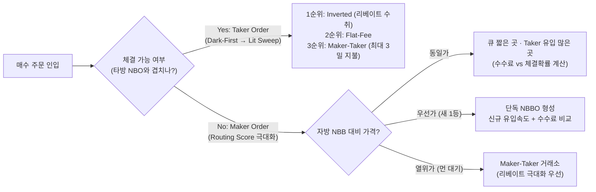

# Chapter 11. 참고: SOR (Smart Order Routing)의 Taker vs Maker 전략

> **원문 위치**: 파트 III. Order Flow > 5. 참고: SOR (Smart Order Routing) (원문 p.56~59) *(주: 원문 제목 오식 `Smaret`을 `Smart`로 교정)*  
> **이 챕터의 핵심 질문**:
> 1. **Taker 주문**(즉시 체결 목적)일 때 SOR은 어떤 순서와 기준(Dark-First → 거래소 수수료 순위)으로 주문을 분배하는가?
> 2. **Maker 주문**(오더북 대기 목적)일 때 SOR의 목표 함수(`Routing Score`)는 무엇이며, 자방 NBBO와의 가격 관계(동일/우선/열위)에 따라 전략이 어떻게 달라지는가?

---

## 1. Taker Order (`Market Order`, 타방 NBBO와 체결 가능한 `Limit Order`)

> 📝 **원문 노트: Taker의 핵심 질문 — 타방 기준 체결 가격**  
> *"어느 거래소가 타방 최우선 가격(NBBO)을 제시하고 있으며, 그 중 **리베이트를 주거나 수수료(`Taker Fee`)를 가장 적게 내는 곳**은 어디인가?"*  
> → 핵심 목표: **즉시 체결(`Immediacy`)** 및 **체결 비용 최소화**

> 💡 **원문 팁: `Taker Order`로만 동작하도록 강제화하는 옵션**  
> **`IOC` (`Immediate or Cancel` / `FAK`: Fill and Kill)**:  
> 타방 NBBO와 즉시 체결 가능한 수량만 체결시키고, 체결되지 않은 잔량은 오더북에 올리지 않고 즉시 소멸시키는 Taker 전용 옵션입니다.

### 1.1 `Dark-First` 탐색
호가를 정규 거래소로 전달하기 전, 수 마이크로초 단위로 자사 내부 및 장외 풀을 먼저 스캔합니다.
1. **브로커 내부화 (`Internalization / Wholesaler Ping`)**:
   - 소액 리테일 주문: 외부 시장에 보내지 않고 브로커 자체 장부(`Desk`)나 제휴 도매 마켓메이커(`Citadel Securities`, `Virtu` 등)와 1:1 체결시킵니다.
   - → `Take Fee` 회피 + 고객에게 NBBO보다 유리한 가격개선(`Price Improvement`) 제공으로 **최선집행(`Best Execution`) 의무 충족**
2. **브로커 및 ATS Dark Pool (`Midpoint Crossing`)**:
   - 브로커 자체 Dark Pool (`Sigma X2`, `JPM-X` 등) 및 독립형 ATS Dark Pool (`Liquidnet` 등)에 대기 중인 기관의 비표시 지정가 주문(`Non-Displayed Orders`)과 체결되도록 합니다.
   - → NBBO 중간가(`Midpoint`) 체결로 양측 모두에게 가격개선 제공 (최선집행 의무 충족)

### 1.2 `Lit 거래소 Sweep` (`Reg NMS Rule 611` 준수)
Dark Pool에서 대기 유동성이 부족해 체결 잔량이 남으면 즉각 Lit 거래소로 라우팅됩니다. 이때부터 `Reg NMS Rule 611`이 엄격 적용되며, SOR은 **순체결 비용을 기준으로 Taker에게 유리한 비용 구조를 가진 거래소부터 순차적으로** 해당 거래소의 NBBO 수량만큼 물량을 배분합니다.

1. **1순위 — 인버티드 거래소 (`Nasdaq BX`, `Cboe BYX`, `EDGA`)**: **Taker 리베이트 수취** (가장 유리)
2. **2순위 — 플랫 피 거래소 (`IEX`, `NYSE National`)**: 저가 고정 수수료
3. **3순위 — 메이커-테이커 거래소 (`Nasdaq`, `NYSE`, `Cboe BZX`, `MEMX`)**: 법정 최고 `Take Fee`(최대 3밀) 지불 (가장 후순위)

> 📝 **원문 노트: `ISO` (`Intermarket Sweep Order`)와 Taker SOR**  
> Taker 입장에서 여러 거래소에 주문을 동시 도달시키지 못하고 순차 체결시키면, 마켓메이커들이 수요를 눈치채고 유리한 가격으로 호가를 즉시 후퇴(`Fade`)시켜 버립니다.  
> 따라서 SOR은 NBBO뿐 아니라 거래소별 차순위 호가·수량·수수료 구조를 모두 계산하고 데이터센터 간 물리적 지연시간까지 계산(`Pacing`)해 모든 매칭 엔진에 정확히 동일 시각에 주문이 도착하도록 분할 발송하면서 **ISO 플래그**를 붙여 제출합니다. ISO를 받은 거래소는 타 거래소 비교(`Trade-through`)를 건너뛰고 자체 오더북 다음 가격단계까지 계속 체결을 발생시킵니다.

---

## 2. Maker Order (타방 NBBO와 체결 불가능한 `Limit Order`)

> 📝 **원문 노트: Maker의 핵심 질문 — 자방 기준 체결 가능성**  
> *"어느 거래소의 자방 호가 대기열이 제일 짧아서 내 주문이 **독성 주문에 체결당하지 않고 안전하게 체결될 확률**이 제일 높은가?"*  
> → 핵심 목표: **체결 확률(`Fill Rate`) 극대화** 및 **역선택(`Adverse Selection`) 방지**
>
> $$\text{Routing Score} = \text{Fill Probability (체결 확률)} - \text{Adverse Selection Risk (역선택 위험)} - \text{Execution Cost (수수료)}$$

> 💡 **원문 팁: `Maker Order`로만 동작하도록 강제화하는 옵션**  
> **`Post-Only (Add-Only)`**:  
> 타방 NBBO와 겹쳐 즉시 체결될 상황이면 거래소가 체결시키지 않고 주문을 자동 취소하거나 가격을 1틱 뒤로 조정(`Price Slide`)해 무조건 `Maker`로만 안착시키도록 강제하는 옵션입니다.

### 2.1 자방 NBBO와 `'동일한 가격'`으로 제출할 때
*(예: 현재 NBB가 `$100.00`인데, 나도 `$100.00`에 매수 지정가 대기 주문을 내는 경우)*
NBBO를 제시 중인 거래소별로 아래 3가지를 종합 분석해 가장 높은 `Routing Score`를 기록한 거래소로 라우팅합니다.
1. **큐 포지션 (`대기 수량`) & 예상 대기 시간**: 과거 통계(체결 속도, 반대편 시장가 주문 유입 가능성 등)를 참조합니다.
   - *(일반적으로 시장가 주문은 Taker 주문이므로 **인버티드 거래소**를 우선 라우팅하므로, 시장가 주문 유입 가능성과 짧은 큐 측면에서 인버티드 거래소가 높게 평가됨)*
2. **수수료 / 리베이트 구조**
3. **기회비용 (`체결을 놓쳐 손해 볼 가능성`, Slippage Risk / Execution Shortfall)**

### 2.2 자방 NBBO보다 `'우선하는 가격'`(단, 타방 NBBO와 체결 불가능한 가격)으로 제출할 때
*(예: 현재 NBBO가 `$100.00 x $100.04`일 때, 내가 `$100.01`로 더 비싸게 매수 지정가 주문을 내는 경우)*
- 어느 거래소에 제출하든지 **내가 새로운 단독 NBBO(1등)가 되므로 기존 큐 포지션을 고려할 필요가 없습니다.**
- 따라서 ① 과거 통계 기반 **신규 호가 유입 속도**만으로 예상 대기 시간을 산출하고, ② **수수료 체계**와 ③ **기회비용**을 종합 고려해 가장 유리한 거래소로 라우팅합니다.

### 2.3 자방 NBBO보다 `'열위의 가격'`으로 제출할 때
*(예: 현재 NBB가 `$100.00`일 때, 내가 `$99.95`로 한참 뒤에 매수 주문을 걸어둘 때)*
- 짧은 시간 안에 체결될 가능성은 낮습니다.
- 따라서 나중에 시장이 내려와 체결될 때 **리베이트를 가장 많이 주는 거래소(`Maker-Taker` 거래소)**로 라우팅하는 전략을 주로 사용합니다.

---

## 추가 설명자료: 쉽게 이해하기

### 핵심 용어 사전

| 용어 | 쉬운 풀이 |
| :--- | :--- |
| **자방 (Same Side) vs 타방 (Contra Side)** | 내가 매수자라면 매수 호가 쪽(NBB)이 **자방**, 매도 호가 쪽(NBO)이 **타방**입니다. 내가 매도자라면 반대가 됩니다. |
| **Taker Order vs Maker Order** | **Taker**: 이미 서 있는 남의 호가를 즉시 먹어 치워 유동성을 빼가는 급한 주문. **Maker**: 오더북에 호가를 올려놓고 남이 와서 먹어주기를 기다리며 유동성을 공급하는 주문. |
| **Price Slide (가격 슬라이드)** | `Post-Only` 주문이 타방 최우선 호가와 겹쳐 Taker가 될 위험이 있을 때, 체결을 피하려고 거래소 시스템이 호가를 자동으로 1틱 불리한 쪽으로 밀어 대기시키는 기능. |

### 쉬운 비유: Taker와 Maker의 정반대 내비게이션

같은 `$100.00` 주식을 사더라도 **"지금 당장 사겠다(Taker)"**와 **"기다렸다 사겠다(Maker)"**에 따라 내비게이션(SOR)이 고르는 거래소 순위가 180도 뒤집힙니다.

- **Taker(당장 살 사람)**는 리베이트까지 얹어주는 **인버티드(`BX/BYX`)** 매대부터 싹 털고, 제일 수수료가 비싼 **메이커-테이커(`Nasdaq/NYSE`)**는 맨 마지막에 갑니다.
- **Maker(싸게 걸어두고 기다릴 사람)**는 어차피 당장 안 팔릴 열위 가격이라면 체결됐을 때 용돈(리베이트)을 제일 많이 주는 **메이커-테이커**에 걸어두고, 반대로 내 가격이 이미 시장 1등가(동일가)라면 줄이 길어 체결 안 되고 물가만 오를까 봐(**기회비용 & 역선택 위험**) 수수료를 내더라도 체결이 빠른 **인버티드**로 갈지 저울질합니다!
